**English** · [简体中文](README.zh_CN.md)

<h1 align="center">🟢 ESP32 Uncle</h1>


<p align="center"><b>Your pocket. Your setup.</b><br>A personal dashboard for the FoloToy AI Passport.</p>

<p align="center">
  <a href="docs/applications/pocket-passport.md"></a>
  <a href="docs/applications/esp32superapp-build.md"></a>
  <a href="companion/README.md"></a>
</p>

<p align="center">
  
  
  
  <a href="LICENSE"></a>
</p>

<p>Swipe left on the cover, or scroll horizontally, to see the other screens. <a href="https://benczb.github.io/esp32-uncle/?lang=en">Open the swipeable gallery →</a></p>

<!-- Nonbreaking spacers keep the image cells readable after GitHub strips CSS. -->
<table><tbody><tr>
<td><a href="https://benczb.github.io/esp32-uncle/?lang=en">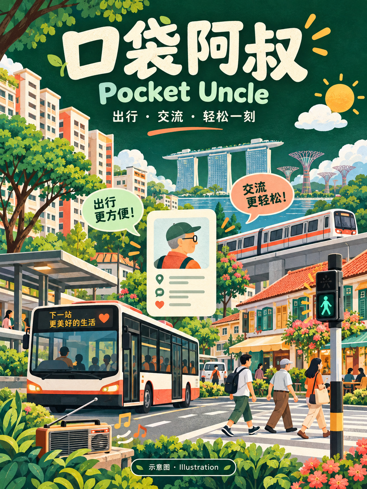</a><br><b>Original cover</b><br><sub aria-hidden="true">&#160;&#160;&#160;&#160;&#160;&#160;&#160;&#160;&#160;&#160;&#160;&#160;&#160;&#160;&#160;&#160;&#160;&#160;&#160;&#160;&#160;&#160;&#160;&#160;&#160;&#160;&#160;&#160;&#160;&#160;&#160;&#160;&#160;&#160;&#160;&#160;&#160;&#160;&#160;&#160;&#160;&#160;&#160;&#160;&#160;&#160;&#160;&#160;&#160;&#160;&#160;&#160;&#160;&#160;&#160;&#160;&#160;&#160;&#160;&#160;&#160;&#160;&#160;&#160;&#160;&#160;&#160;&#160;&#160;&#160;&#160;&#160;&#160;&#160;&#160;&#160;&#160;&#160;&#160;&#160;&#160;&#160;&#160;&#160;&#160;&#160;&#160;&#160;&#160;&#160;&#160;&#160;&#160;&#160;&#160;&#160;&#160;&#160;&#160;&#160;&#160;&#160;&#160;&#160;&#160;&#160;&#160;&#160;&#160;&#160;&#160;&#160;&#160;&#160;&#160;&#160;&#160;&#160;&#160;&#160;&#160;&#160;&#160;&#160;&#160;&#160;&#160;&#160;&#160;&#160;&#160;&#160;&#160;&#160;&#160;&#160;&#160;&#160;&#160;&#160;</sub></td>
<td><a href="https://benczb.github.io/esp32-uncle/?lang=en">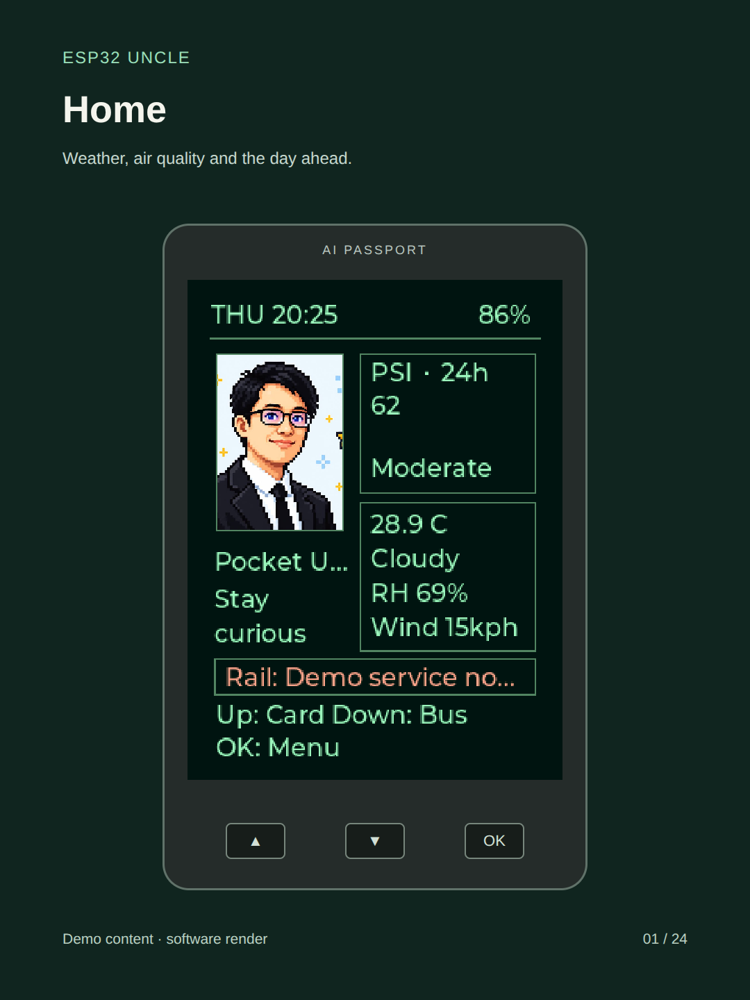</a><br><b>Home</b><br><sub aria-hidden="true">&#160;&#160;&#160;&#160;&#160;&#160;&#160;&#160;&#160;&#160;&#160;&#160;&#160;&#160;&#160;&#160;&#160;&#160;&#160;&#160;&#160;&#160;&#160;&#160;&#160;&#160;&#160;&#160;&#160;&#160;&#160;&#160;&#160;&#160;&#160;&#160;&#160;&#160;&#160;&#160;&#160;&#160;&#160;&#160;&#160;&#160;&#160;&#160;&#160;&#160;&#160;&#160;&#160;&#160;&#160;&#160;&#160;&#160;&#160;&#160;&#160;&#160;&#160;&#160;&#160;&#160;&#160;&#160;&#160;&#160;&#160;&#160;&#160;&#160;&#160;&#160;&#160;&#160;&#160;&#160;&#160;&#160;&#160;&#160;&#160;&#160;&#160;&#160;&#160;&#160;&#160;&#160;&#160;&#160;&#160;&#160;&#160;&#160;&#160;&#160;&#160;&#160;&#160;&#160;&#160;&#160;&#160;&#160;&#160;&#160;&#160;&#160;&#160;&#160;&#160;&#160;&#160;&#160;&#160;&#160;&#160;&#160;&#160;&#160;&#160;&#160;&#160;&#160;&#160;&#160;&#160;&#160;&#160;&#160;&#160;&#160;&#160;&#160;&#160;&#160;</sub></td>
<td><a href="https://benczb.github.io/esp32-uncle/?lang=en">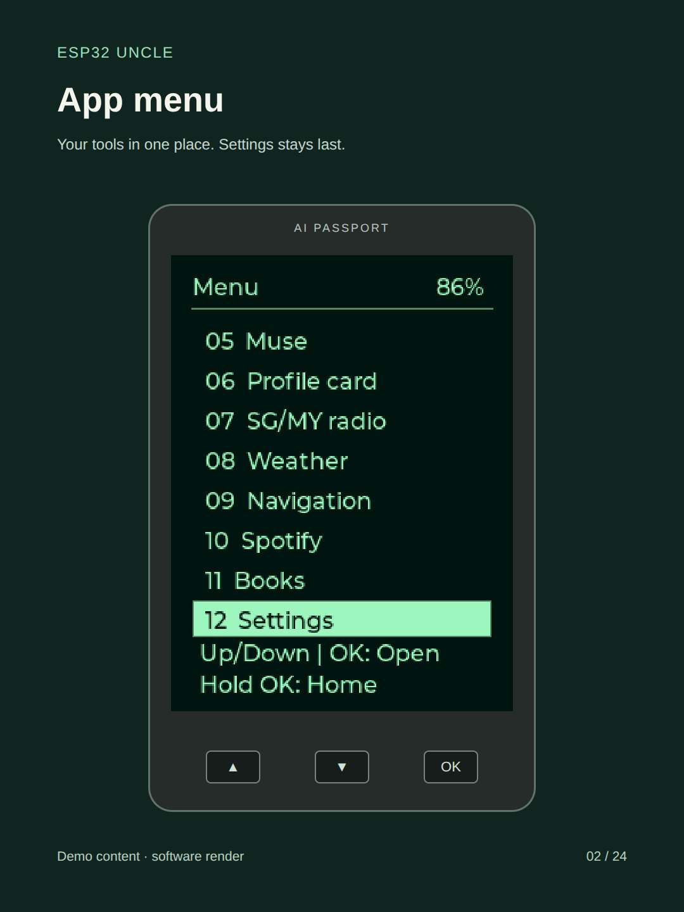</a><br><b>App menu</b><br><sub aria-hidden="true">&#160;&#160;&#160;&#160;&#160;&#160;&#160;&#160;&#160;&#160;&#160;&#160;&#160;&#160;&#160;&#160;&#160;&#160;&#160;&#160;&#160;&#160;&#160;&#160;&#160;&#160;&#160;&#160;&#160;&#160;&#160;&#160;&#160;&#160;&#160;&#160;&#160;&#160;&#160;&#160;&#160;&#160;&#160;&#160;&#160;&#160;&#160;&#160;&#160;&#160;&#160;&#160;&#160;&#160;&#160;&#160;&#160;&#160;&#160;&#160;&#160;&#160;&#160;&#160;&#160;&#160;&#160;&#160;&#160;&#160;&#160;&#160;&#160;&#160;&#160;&#160;&#160;&#160;&#160;&#160;&#160;&#160;&#160;&#160;&#160;&#160;&#160;&#160;&#160;&#160;&#160;&#160;&#160;&#160;&#160;&#160;&#160;&#160;&#160;&#160;&#160;&#160;&#160;&#160;&#160;&#160;&#160;&#160;&#160;&#160;&#160;&#160;&#160;&#160;&#160;&#160;&#160;&#160;&#160;&#160;&#160;&#160;&#160;&#160;&#160;&#160;&#160;&#160;&#160;&#160;&#160;&#160;&#160;&#160;&#160;&#160;&#160;&#160;&#160;&#160;</sub></td>
<td><a href="https://benczb.github.io/esp32-uncle/?lang=en">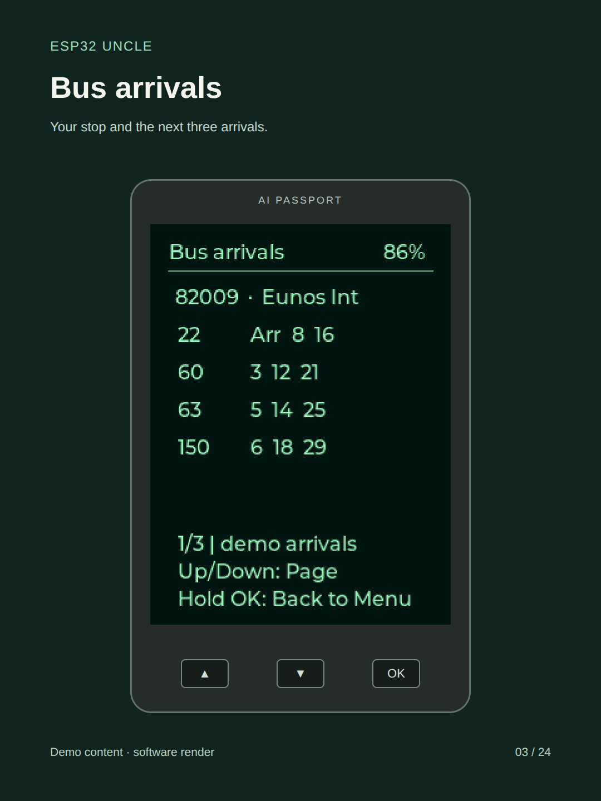</a><br><b>Bus arrivals</b><br><sub aria-hidden="true">&#160;&#160;&#160;&#160;&#160;&#160;&#160;&#160;&#160;&#160;&#160;&#160;&#160;&#160;&#160;&#160;&#160;&#160;&#160;&#160;&#160;&#160;&#160;&#160;&#160;&#160;&#160;&#160;&#160;&#160;&#160;&#160;&#160;&#160;&#160;&#160;&#160;&#160;&#160;&#160;&#160;&#160;&#160;&#160;&#160;&#160;&#160;&#160;&#160;&#160;&#160;&#160;&#160;&#160;&#160;&#160;&#160;&#160;&#160;&#160;&#160;&#160;&#160;&#160;&#160;&#160;&#160;&#160;&#160;&#160;&#160;&#160;&#160;&#160;&#160;&#160;&#160;&#160;&#160;&#160;&#160;&#160;&#160;&#160;&#160;&#160;&#160;&#160;&#160;&#160;&#160;&#160;&#160;&#160;&#160;&#160;&#160;&#160;&#160;&#160;&#160;&#160;&#160;&#160;&#160;&#160;&#160;&#160;&#160;&#160;&#160;&#160;&#160;&#160;&#160;&#160;&#160;&#160;&#160;&#160;&#160;&#160;&#160;&#160;&#160;&#160;&#160;&#160;&#160;&#160;&#160;&#160;&#160;&#160;&#160;&#160;&#160;&#160;&#160;&#160;</sub></td>
<td><a href="https://benczb.github.io/esp32-uncle/?lang=en">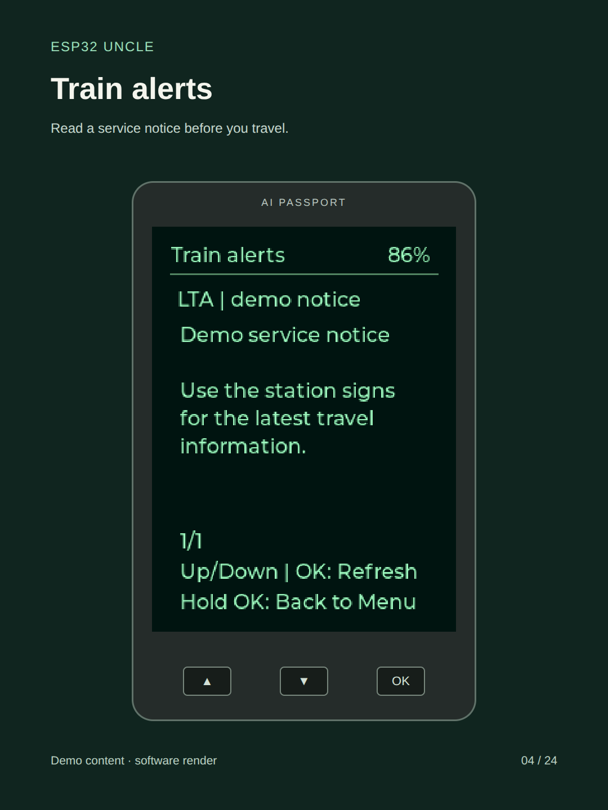</a><br><b>Train alerts</b><br><sub aria-hidden="true">&#160;&#160;&#160;&#160;&#160;&#160;&#160;&#160;&#160;&#160;&#160;&#160;&#160;&#160;&#160;&#160;&#160;&#160;&#160;&#160;&#160;&#160;&#160;&#160;&#160;&#160;&#160;&#160;&#160;&#160;&#160;&#160;&#160;&#160;&#160;&#160;&#160;&#160;&#160;&#160;&#160;&#160;&#160;&#160;&#160;&#160;&#160;&#160;&#160;&#160;&#160;&#160;&#160;&#160;&#160;&#160;&#160;&#160;&#160;&#160;&#160;&#160;&#160;&#160;&#160;&#160;&#160;&#160;&#160;&#160;&#160;&#160;&#160;&#160;&#160;&#160;&#160;&#160;&#160;&#160;&#160;&#160;&#160;&#160;&#160;&#160;&#160;&#160;&#160;&#160;&#160;&#160;&#160;&#160;&#160;&#160;&#160;&#160;&#160;&#160;&#160;&#160;&#160;&#160;&#160;&#160;&#160;&#160;&#160;&#160;&#160;&#160;&#160;&#160;&#160;&#160;&#160;&#160;&#160;&#160;&#160;&#160;&#160;&#160;&#160;&#160;&#160;&#160;&#160;&#160;&#160;&#160;&#160;&#160;&#160;&#160;&#160;&#160;&#160;&#160;</sub></td>
<td><a href="https://benczb.github.io/esp32-uncle/?lang=en">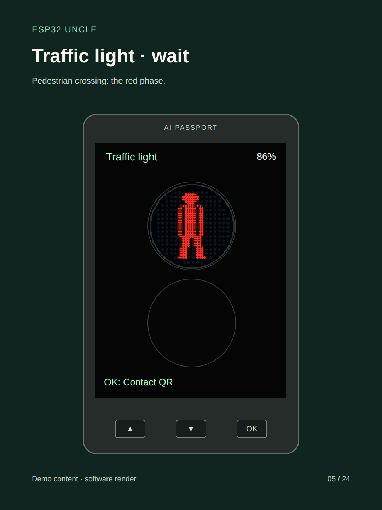</a><br><b>Traffic light · wait</b><br><sub aria-hidden="true">&#160;&#160;&#160;&#160;&#160;&#160;&#160;&#160;&#160;&#160;&#160;&#160;&#160;&#160;&#160;&#160;&#160;&#160;&#160;&#160;&#160;&#160;&#160;&#160;&#160;&#160;&#160;&#160;&#160;&#160;&#160;&#160;&#160;&#160;&#160;&#160;&#160;&#160;&#160;&#160;&#160;&#160;&#160;&#160;&#160;&#160;&#160;&#160;&#160;&#160;&#160;&#160;&#160;&#160;&#160;&#160;&#160;&#160;&#160;&#160;&#160;&#160;&#160;&#160;&#160;&#160;&#160;&#160;&#160;&#160;&#160;&#160;&#160;&#160;&#160;&#160;&#160;&#160;&#160;&#160;&#160;&#160;&#160;&#160;&#160;&#160;&#160;&#160;&#160;&#160;&#160;&#160;&#160;&#160;&#160;&#160;&#160;&#160;&#160;&#160;&#160;&#160;&#160;&#160;&#160;&#160;&#160;&#160;&#160;&#160;&#160;&#160;&#160;&#160;&#160;&#160;&#160;&#160;&#160;&#160;&#160;&#160;&#160;&#160;&#160;&#160;&#160;&#160;&#160;&#160;&#160;&#160;&#160;&#160;&#160;&#160;&#160;&#160;&#160;&#160;</sub></td>
<td><a href="https://benczb.github.io/esp32-uncle/?lang=en">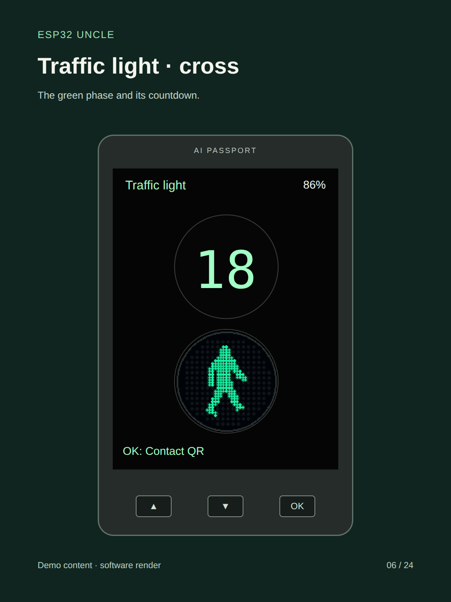</a><br><b>Traffic light · cross</b><br><sub aria-hidden="true">&#160;&#160;&#160;&#160;&#160;&#160;&#160;&#160;&#160;&#160;&#160;&#160;&#160;&#160;&#160;&#160;&#160;&#160;&#160;&#160;&#160;&#160;&#160;&#160;&#160;&#160;&#160;&#160;&#160;&#160;&#160;&#160;&#160;&#160;&#160;&#160;&#160;&#160;&#160;&#160;&#160;&#160;&#160;&#160;&#160;&#160;&#160;&#160;&#160;&#160;&#160;&#160;&#160;&#160;&#160;&#160;&#160;&#160;&#160;&#160;&#160;&#160;&#160;&#160;&#160;&#160;&#160;&#160;&#160;&#160;&#160;&#160;&#160;&#160;&#160;&#160;&#160;&#160;&#160;&#160;&#160;&#160;&#160;&#160;&#160;&#160;&#160;&#160;&#160;&#160;&#160;&#160;&#160;&#160;&#160;&#160;&#160;&#160;&#160;&#160;&#160;&#160;&#160;&#160;&#160;&#160;&#160;&#160;&#160;&#160;&#160;&#160;&#160;&#160;&#160;&#160;&#160;&#160;&#160;&#160;&#160;&#160;&#160;&#160;&#160;&#160;&#160;&#160;&#160;&#160;&#160;&#160;&#160;&#160;&#160;&#160;&#160;&#160;&#160;&#160;</sub></td>
<td><a href="https://benczb.github.io/esp32-uncle/?lang=en">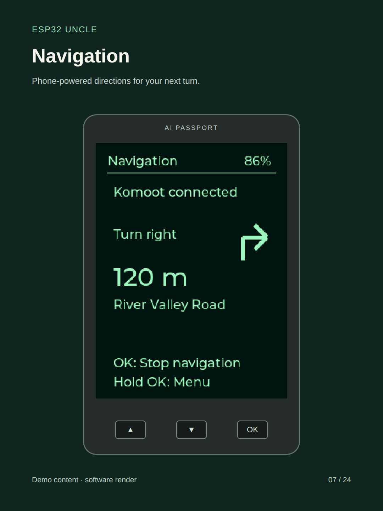</a><br><b>Navigation</b><br><sub aria-hidden="true">&#160;&#160;&#160;&#160;&#160;&#160;&#160;&#160;&#160;&#160;&#160;&#160;&#160;&#160;&#160;&#160;&#160;&#160;&#160;&#160;&#160;&#160;&#160;&#160;&#160;&#160;&#160;&#160;&#160;&#160;&#160;&#160;&#160;&#160;&#160;&#160;&#160;&#160;&#160;&#160;&#160;&#160;&#160;&#160;&#160;&#160;&#160;&#160;&#160;&#160;&#160;&#160;&#160;&#160;&#160;&#160;&#160;&#160;&#160;&#160;&#160;&#160;&#160;&#160;&#160;&#160;&#160;&#160;&#160;&#160;&#160;&#160;&#160;&#160;&#160;&#160;&#160;&#160;&#160;&#160;&#160;&#160;&#160;&#160;&#160;&#160;&#160;&#160;&#160;&#160;&#160;&#160;&#160;&#160;&#160;&#160;&#160;&#160;&#160;&#160;&#160;&#160;&#160;&#160;&#160;&#160;&#160;&#160;&#160;&#160;&#160;&#160;&#160;&#160;&#160;&#160;&#160;&#160;&#160;&#160;&#160;&#160;&#160;&#160;&#160;&#160;&#160;&#160;&#160;&#160;&#160;&#160;&#160;&#160;&#160;&#160;&#160;&#160;&#160;&#160;</sub></td>
<td><a href="https://benczb.github.io/esp32-uncle/?lang=en">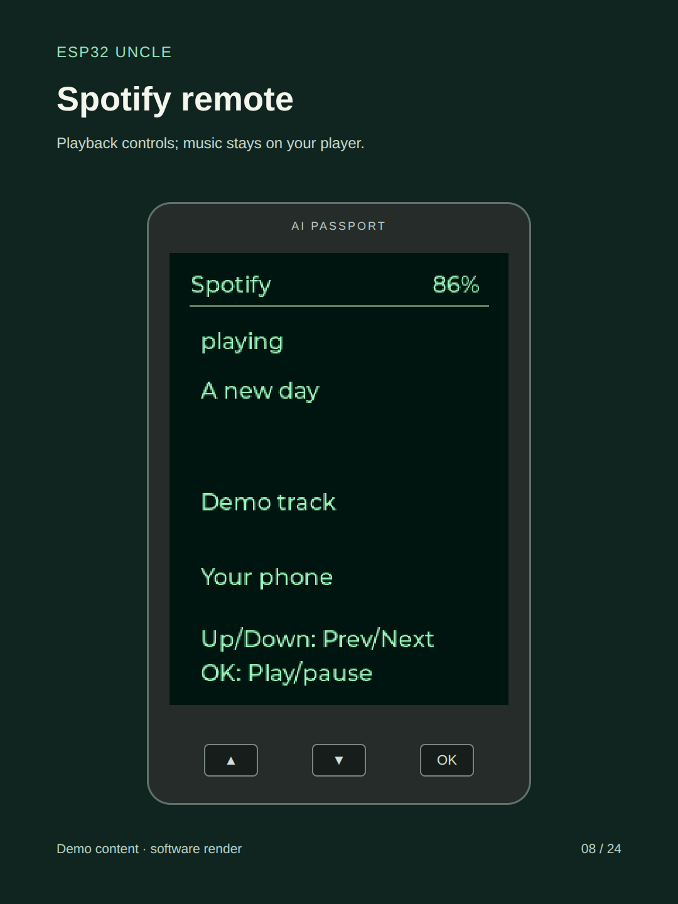</a><br><b>Spotify remote</b><br><sub aria-hidden="true">&#160;&#160;&#160;&#160;&#160;&#160;&#160;&#160;&#160;&#160;&#160;&#160;&#160;&#160;&#160;&#160;&#160;&#160;&#160;&#160;&#160;&#160;&#160;&#160;&#160;&#160;&#160;&#160;&#160;&#160;&#160;&#160;&#160;&#160;&#160;&#160;&#160;&#160;&#160;&#160;&#160;&#160;&#160;&#160;&#160;&#160;&#160;&#160;&#160;&#160;&#160;&#160;&#160;&#160;&#160;&#160;&#160;&#160;&#160;&#160;&#160;&#160;&#160;&#160;&#160;&#160;&#160;&#160;&#160;&#160;&#160;&#160;&#160;&#160;&#160;&#160;&#160;&#160;&#160;&#160;&#160;&#160;&#160;&#160;&#160;&#160;&#160;&#160;&#160;&#160;&#160;&#160;&#160;&#160;&#160;&#160;&#160;&#160;&#160;&#160;&#160;&#160;&#160;&#160;&#160;&#160;&#160;&#160;&#160;&#160;&#160;&#160;&#160;&#160;&#160;&#160;&#160;&#160;&#160;&#160;&#160;&#160;&#160;&#160;&#160;&#160;&#160;&#160;&#160;&#160;&#160;&#160;&#160;&#160;&#160;&#160;&#160;&#160;&#160;&#160;</sub></td>
<td><a href="https://benczb.github.io/esp32-uncle/?lang=en">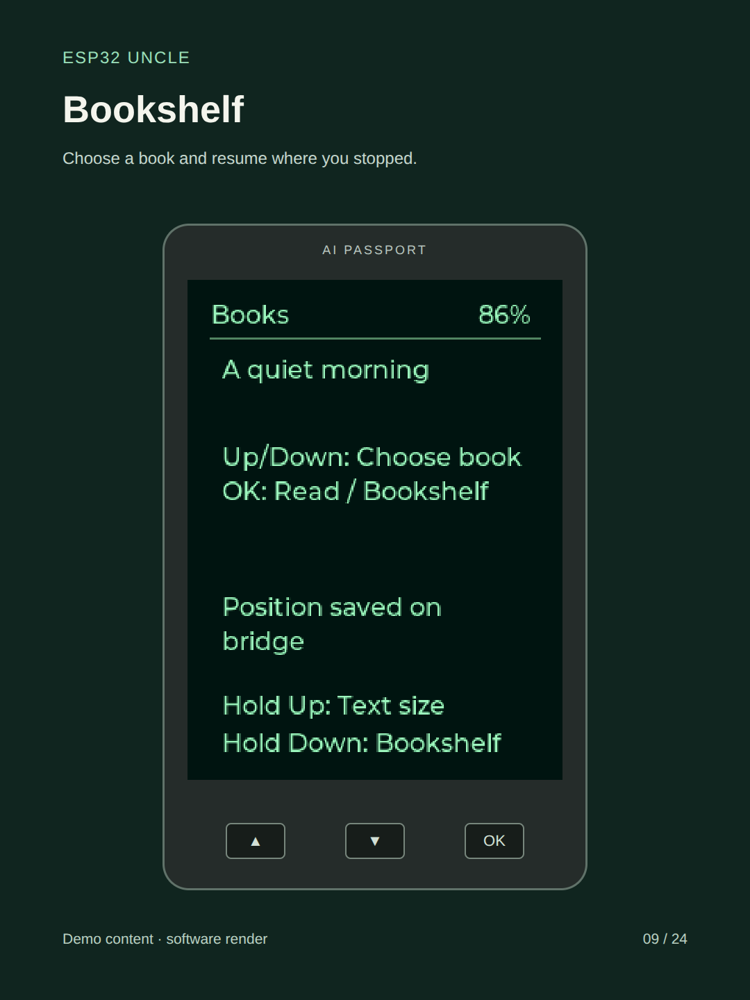</a><br><b>Bookshelf</b><br><sub aria-hidden="true">&#160;&#160;&#160;&#160;&#160;&#160;&#160;&#160;&#160;&#160;&#160;&#160;&#160;&#160;&#160;&#160;&#160;&#160;&#160;&#160;&#160;&#160;&#160;&#160;&#160;&#160;&#160;&#160;&#160;&#160;&#160;&#160;&#160;&#160;&#160;&#160;&#160;&#160;&#160;&#160;&#160;&#160;&#160;&#160;&#160;&#160;&#160;&#160;&#160;&#160;&#160;&#160;&#160;&#160;&#160;&#160;&#160;&#160;&#160;&#160;&#160;&#160;&#160;&#160;&#160;&#160;&#160;&#160;&#160;&#160;&#160;&#160;&#160;&#160;&#160;&#160;&#160;&#160;&#160;&#160;&#160;&#160;&#160;&#160;&#160;&#160;&#160;&#160;&#160;&#160;&#160;&#160;&#160;&#160;&#160;&#160;&#160;&#160;&#160;&#160;&#160;&#160;&#160;&#160;&#160;&#160;&#160;&#160;&#160;&#160;&#160;&#160;&#160;&#160;&#160;&#160;&#160;&#160;&#160;&#160;&#160;&#160;&#160;&#160;&#160;&#160;&#160;&#160;&#160;&#160;&#160;&#160;&#160;&#160;&#160;&#160;&#160;&#160;&#160;&#160;</sub></td>
<td><a href="https://benczb.github.io/esp32-uncle/?lang=en">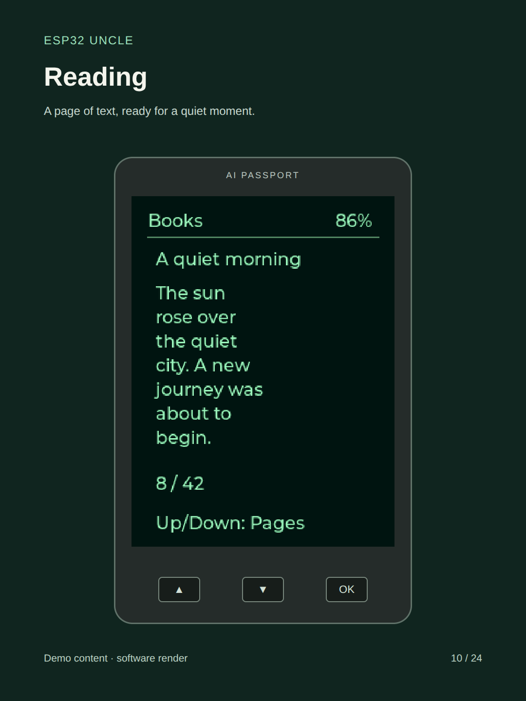</a><br><b>Reading</b><br><sub aria-hidden="true">&#160;&#160;&#160;&#160;&#160;&#160;&#160;&#160;&#160;&#160;&#160;&#160;&#160;&#160;&#160;&#160;&#160;&#160;&#160;&#160;&#160;&#160;&#160;&#160;&#160;&#160;&#160;&#160;&#160;&#160;&#160;&#160;&#160;&#160;&#160;&#160;&#160;&#160;&#160;&#160;&#160;&#160;&#160;&#160;&#160;&#160;&#160;&#160;&#160;&#160;&#160;&#160;&#160;&#160;&#160;&#160;&#160;&#160;&#160;&#160;&#160;&#160;&#160;&#160;&#160;&#160;&#160;&#160;&#160;&#160;&#160;&#160;&#160;&#160;&#160;&#160;&#160;&#160;&#160;&#160;&#160;&#160;&#160;&#160;&#160;&#160;&#160;&#160;&#160;&#160;&#160;&#160;&#160;&#160;&#160;&#160;&#160;&#160;&#160;&#160;&#160;&#160;&#160;&#160;&#160;&#160;&#160;&#160;&#160;&#160;&#160;&#160;&#160;&#160;&#160;&#160;&#160;&#160;&#160;&#160;&#160;&#160;&#160;&#160;&#160;&#160;&#160;&#160;&#160;&#160;&#160;&#160;&#160;&#160;&#160;&#160;&#160;&#160;&#160;&#160;</sub></td>
<td><a href="https://benczb.github.io/esp32-uncle/?lang=en">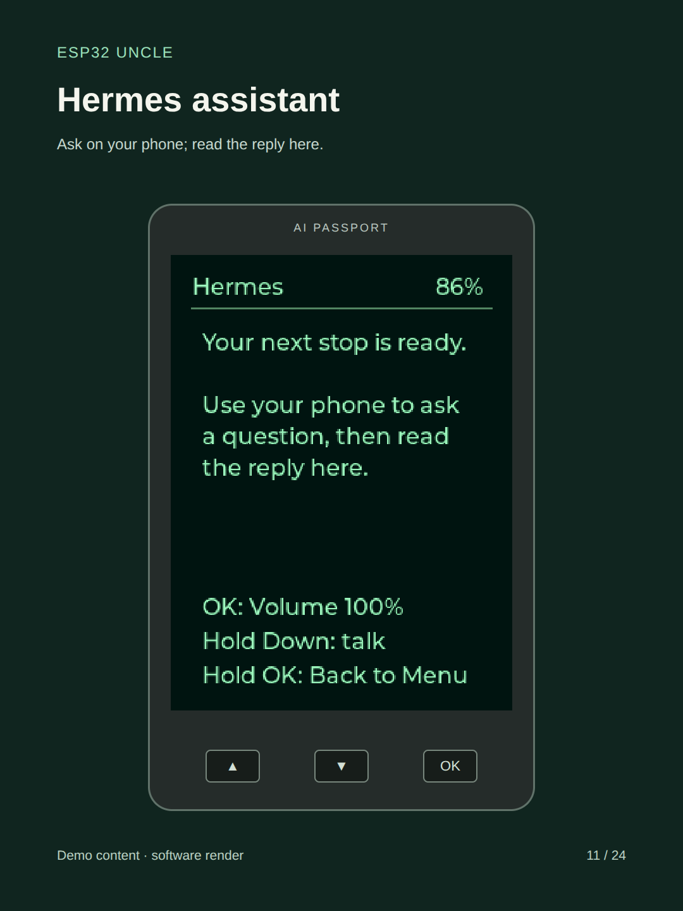</a><br><b>Hermes assistant</b><br><sub aria-hidden="true">&#160;&#160;&#160;&#160;&#160;&#160;&#160;&#160;&#160;&#160;&#160;&#160;&#160;&#160;&#160;&#160;&#160;&#160;&#160;&#160;&#160;&#160;&#160;&#160;&#160;&#160;&#160;&#160;&#160;&#160;&#160;&#160;&#160;&#160;&#160;&#160;&#160;&#160;&#160;&#160;&#160;&#160;&#160;&#160;&#160;&#160;&#160;&#160;&#160;&#160;&#160;&#160;&#160;&#160;&#160;&#160;&#160;&#160;&#160;&#160;&#160;&#160;&#160;&#160;&#160;&#160;&#160;&#160;&#160;&#160;&#160;&#160;&#160;&#160;&#160;&#160;&#160;&#160;&#160;&#160;&#160;&#160;&#160;&#160;&#160;&#160;&#160;&#160;&#160;&#160;&#160;&#160;&#160;&#160;&#160;&#160;&#160;&#160;&#160;&#160;&#160;&#160;&#160;&#160;&#160;&#160;&#160;&#160;&#160;&#160;&#160;&#160;&#160;&#160;&#160;&#160;&#160;&#160;&#160;&#160;&#160;&#160;&#160;&#160;&#160;&#160;&#160;&#160;&#160;&#160;&#160;&#160;&#160;&#160;&#160;&#160;&#160;&#160;&#160;&#160;</sub></td>
<td><a href="https://benczb.github.io/esp32-uncle/?lang=en">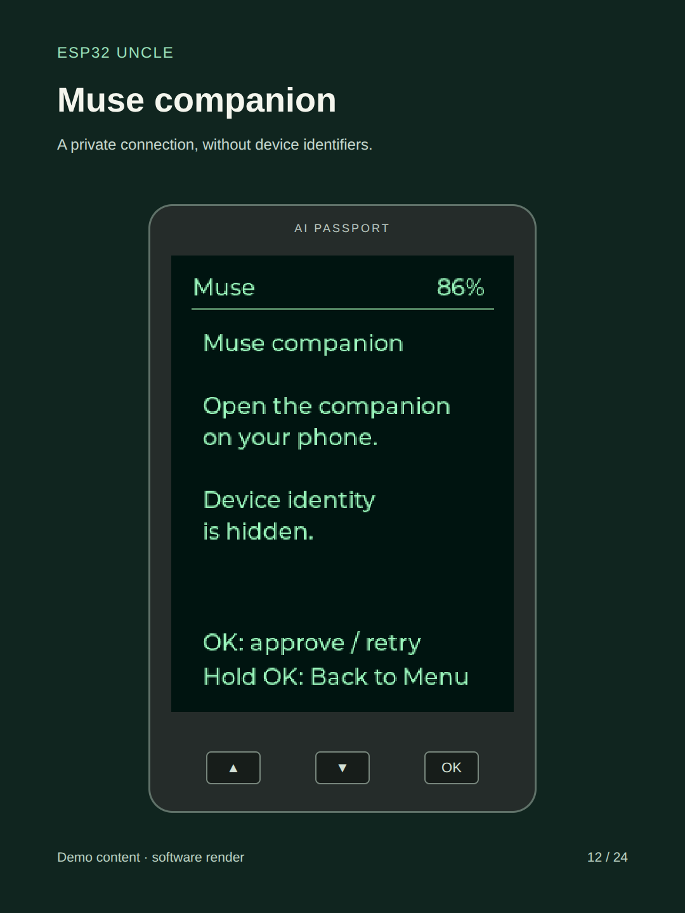</a><br><b>Muse companion</b><br><sub aria-hidden="true">&#160;&#160;&#160;&#160;&#160;&#160;&#160;&#160;&#160;&#160;&#160;&#160;&#160;&#160;&#160;&#160;&#160;&#160;&#160;&#160;&#160;&#160;&#160;&#160;&#160;&#160;&#160;&#160;&#160;&#160;&#160;&#160;&#160;&#160;&#160;&#160;&#160;&#160;&#160;&#160;&#160;&#160;&#160;&#160;&#160;&#160;&#160;&#160;&#160;&#160;&#160;&#160;&#160;&#160;&#160;&#160;&#160;&#160;&#160;&#160;&#160;&#160;&#160;&#160;&#160;&#160;&#160;&#160;&#160;&#160;&#160;&#160;&#160;&#160;&#160;&#160;&#160;&#160;&#160;&#160;&#160;&#160;&#160;&#160;&#160;&#160;&#160;&#160;&#160;&#160;&#160;&#160;&#160;&#160;&#160;&#160;&#160;&#160;&#160;&#160;&#160;&#160;&#160;&#160;&#160;&#160;&#160;&#160;&#160;&#160;&#160;&#160;&#160;&#160;&#160;&#160;&#160;&#160;&#160;&#160;&#160;&#160;&#160;&#160;&#160;&#160;&#160;&#160;&#160;&#160;&#160;&#160;&#160;&#160;&#160;&#160;&#160;&#160;&#160;&#160;</sub></td>
<td><a href="https://benczb.github.io/esp32-uncle/?lang=en">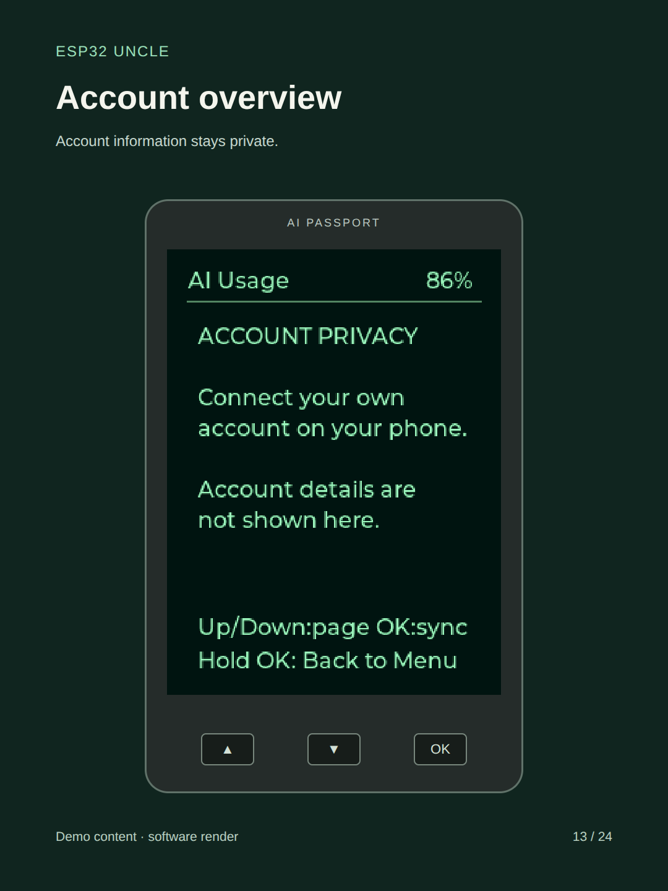</a><br><b>Account overview</b><br><sub aria-hidden="true">&#160;&#160;&#160;&#160;&#160;&#160;&#160;&#160;&#160;&#160;&#160;&#160;&#160;&#160;&#160;&#160;&#160;&#160;&#160;&#160;&#160;&#160;&#160;&#160;&#160;&#160;&#160;&#160;&#160;&#160;&#160;&#160;&#160;&#160;&#160;&#160;&#160;&#160;&#160;&#160;&#160;&#160;&#160;&#160;&#160;&#160;&#160;&#160;&#160;&#160;&#160;&#160;&#160;&#160;&#160;&#160;&#160;&#160;&#160;&#160;&#160;&#160;&#160;&#160;&#160;&#160;&#160;&#160;&#160;&#160;&#160;&#160;&#160;&#160;&#160;&#160;&#160;&#160;&#160;&#160;&#160;&#160;&#160;&#160;&#160;&#160;&#160;&#160;&#160;&#160;&#160;&#160;&#160;&#160;&#160;&#160;&#160;&#160;&#160;&#160;&#160;&#160;&#160;&#160;&#160;&#160;&#160;&#160;&#160;&#160;&#160;&#160;&#160;&#160;&#160;&#160;&#160;&#160;&#160;&#160;&#160;&#160;&#160;&#160;&#160;&#160;&#160;&#160;&#160;&#160;&#160;&#160;&#160;&#160;&#160;&#160;&#160;&#160;&#160;&#160;</sub></td>
<td><a href="https://benczb.github.io/esp32-uncle/?lang=en">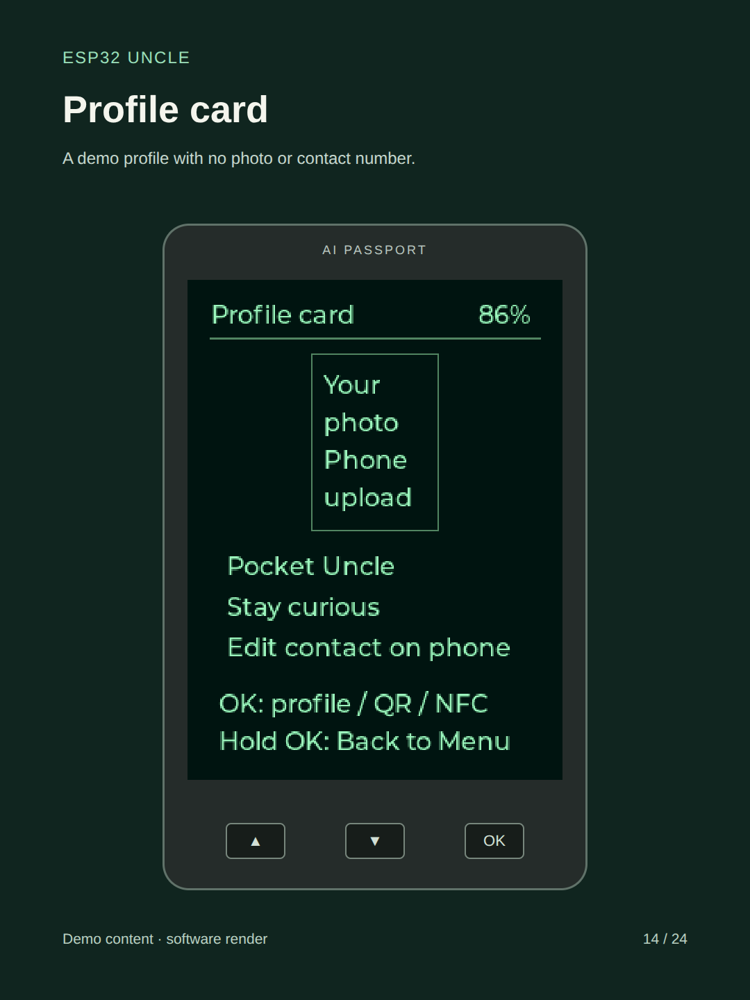</a><br><b>Profile card</b><br><sub aria-hidden="true">&#160;&#160;&#160;&#160;&#160;&#160;&#160;&#160;&#160;&#160;&#160;&#160;&#160;&#160;&#160;&#160;&#160;&#160;&#160;&#160;&#160;&#160;&#160;&#160;&#160;&#160;&#160;&#160;&#160;&#160;&#160;&#160;&#160;&#160;&#160;&#160;&#160;&#160;&#160;&#160;&#160;&#160;&#160;&#160;&#160;&#160;&#160;&#160;&#160;&#160;&#160;&#160;&#160;&#160;&#160;&#160;&#160;&#160;&#160;&#160;&#160;&#160;&#160;&#160;&#160;&#160;&#160;&#160;&#160;&#160;&#160;&#160;&#160;&#160;&#160;&#160;&#160;&#160;&#160;&#160;&#160;&#160;&#160;&#160;&#160;&#160;&#160;&#160;&#160;&#160;&#160;&#160;&#160;&#160;&#160;&#160;&#160;&#160;&#160;&#160;&#160;&#160;&#160;&#160;&#160;&#160;&#160;&#160;&#160;&#160;&#160;&#160;&#160;&#160;&#160;&#160;&#160;&#160;&#160;&#160;&#160;&#160;&#160;&#160;&#160;&#160;&#160;&#160;&#160;&#160;&#160;&#160;&#160;&#160;&#160;&#160;&#160;&#160;&#160;&#160;</sub></td>
<td><a href="https://benczb.github.io/esp32-uncle/?lang=en">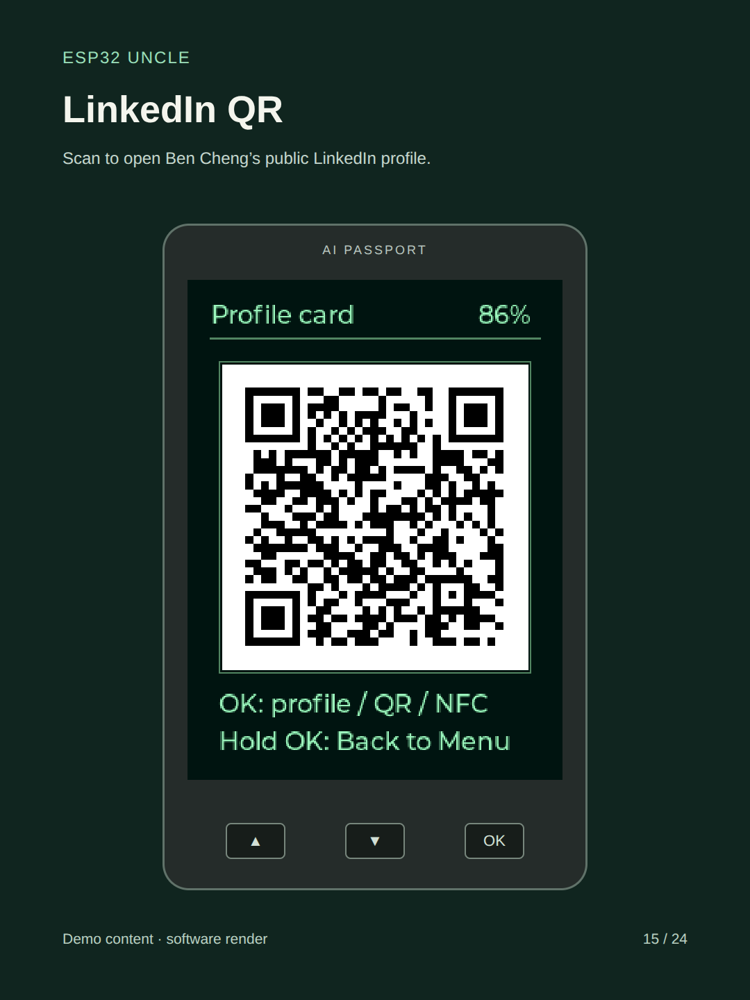</a><br><b>LinkedIn QR</b><br><sub aria-hidden="true">&#160;&#160;&#160;&#160;&#160;&#160;&#160;&#160;&#160;&#160;&#160;&#160;&#160;&#160;&#160;&#160;&#160;&#160;&#160;&#160;&#160;&#160;&#160;&#160;&#160;&#160;&#160;&#160;&#160;&#160;&#160;&#160;&#160;&#160;&#160;&#160;&#160;&#160;&#160;&#160;&#160;&#160;&#160;&#160;&#160;&#160;&#160;&#160;&#160;&#160;&#160;&#160;&#160;&#160;&#160;&#160;&#160;&#160;&#160;&#160;&#160;&#160;&#160;&#160;&#160;&#160;&#160;&#160;&#160;&#160;&#160;&#160;&#160;&#160;&#160;&#160;&#160;&#160;&#160;&#160;&#160;&#160;&#160;&#160;&#160;&#160;&#160;&#160;&#160;&#160;&#160;&#160;&#160;&#160;&#160;&#160;&#160;&#160;&#160;&#160;&#160;&#160;&#160;&#160;&#160;&#160;&#160;&#160;&#160;&#160;&#160;&#160;&#160;&#160;&#160;&#160;&#160;&#160;&#160;&#160;&#160;&#160;&#160;&#160;&#160;&#160;&#160;&#160;&#160;&#160;&#160;&#160;&#160;&#160;&#160;&#160;&#160;&#160;&#160;&#160;</sub></td>
<td><a href="https://benczb.github.io/esp32-uncle/?lang=en">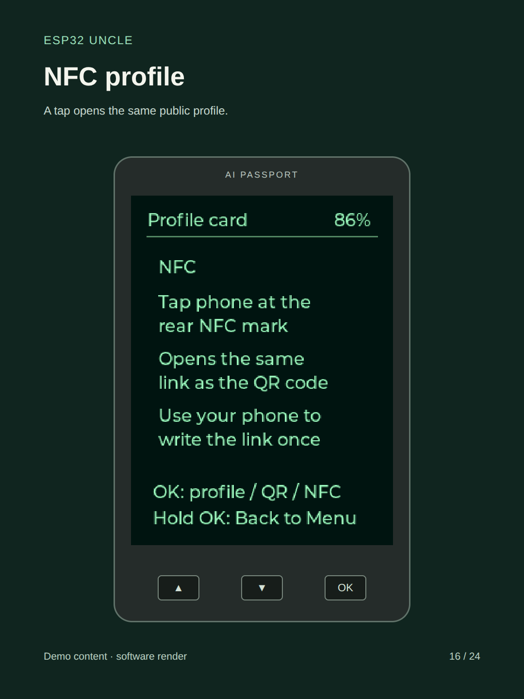</a><br><b>NFC profile</b><br><sub aria-hidden="true">&#160;&#160;&#160;&#160;&#160;&#160;&#160;&#160;&#160;&#160;&#160;&#160;&#160;&#160;&#160;&#160;&#160;&#160;&#160;&#160;&#160;&#160;&#160;&#160;&#160;&#160;&#160;&#160;&#160;&#160;&#160;&#160;&#160;&#160;&#160;&#160;&#160;&#160;&#160;&#160;&#160;&#160;&#160;&#160;&#160;&#160;&#160;&#160;&#160;&#160;&#160;&#160;&#160;&#160;&#160;&#160;&#160;&#160;&#160;&#160;&#160;&#160;&#160;&#160;&#160;&#160;&#160;&#160;&#160;&#160;&#160;&#160;&#160;&#160;&#160;&#160;&#160;&#160;&#160;&#160;&#160;&#160;&#160;&#160;&#160;&#160;&#160;&#160;&#160;&#160;&#160;&#160;&#160;&#160;&#160;&#160;&#160;&#160;&#160;&#160;&#160;&#160;&#160;&#160;&#160;&#160;&#160;&#160;&#160;&#160;&#160;&#160;&#160;&#160;&#160;&#160;&#160;&#160;&#160;&#160;&#160;&#160;&#160;&#160;&#160;&#160;&#160;&#160;&#160;&#160;&#160;&#160;&#160;&#160;&#160;&#160;&#160;&#160;&#160;&#160;</sub></td>
<td><a href="https://benczb.github.io/esp32-uncle/?lang=en">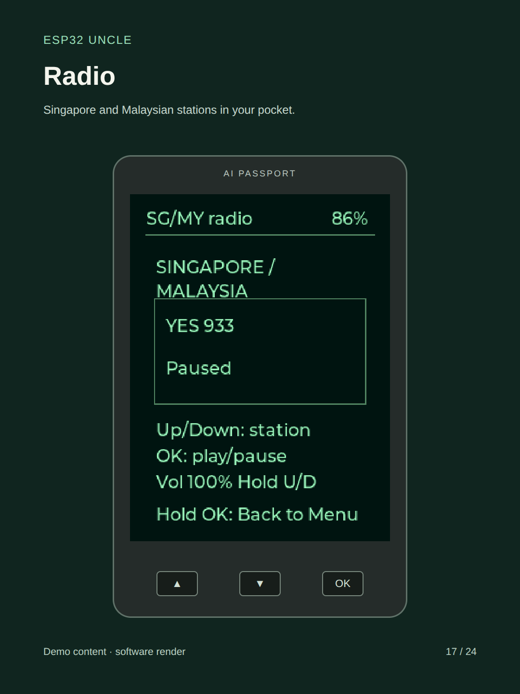</a><br><b>Radio</b><br><sub aria-hidden="true">&#160;&#160;&#160;&#160;&#160;&#160;&#160;&#160;&#160;&#160;&#160;&#160;&#160;&#160;&#160;&#160;&#160;&#160;&#160;&#160;&#160;&#160;&#160;&#160;&#160;&#160;&#160;&#160;&#160;&#160;&#160;&#160;&#160;&#160;&#160;&#160;&#160;&#160;&#160;&#160;&#160;&#160;&#160;&#160;&#160;&#160;&#160;&#160;&#160;&#160;&#160;&#160;&#160;&#160;&#160;&#160;&#160;&#160;&#160;&#160;&#160;&#160;&#160;&#160;&#160;&#160;&#160;&#160;&#160;&#160;&#160;&#160;&#160;&#160;&#160;&#160;&#160;&#160;&#160;&#160;&#160;&#160;&#160;&#160;&#160;&#160;&#160;&#160;&#160;&#160;&#160;&#160;&#160;&#160;&#160;&#160;&#160;&#160;&#160;&#160;&#160;&#160;&#160;&#160;&#160;&#160;&#160;&#160;&#160;&#160;&#160;&#160;&#160;&#160;&#160;&#160;&#160;&#160;&#160;&#160;&#160;&#160;&#160;&#160;&#160;&#160;&#160;&#160;&#160;&#160;&#160;&#160;&#160;&#160;&#160;&#160;&#160;&#160;&#160;&#160;</sub></td>
<td><a href="https://benczb.github.io/esp32-uncle/?lang=en">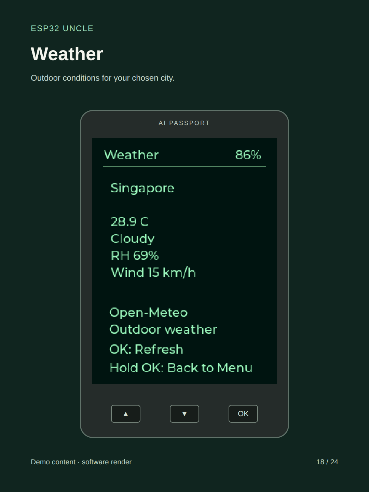</a><br><b>Weather</b><br><sub aria-hidden="true">&#160;&#160;&#160;&#160;&#160;&#160;&#160;&#160;&#160;&#160;&#160;&#160;&#160;&#160;&#160;&#160;&#160;&#160;&#160;&#160;&#160;&#160;&#160;&#160;&#160;&#160;&#160;&#160;&#160;&#160;&#160;&#160;&#160;&#160;&#160;&#160;&#160;&#160;&#160;&#160;&#160;&#160;&#160;&#160;&#160;&#160;&#160;&#160;&#160;&#160;&#160;&#160;&#160;&#160;&#160;&#160;&#160;&#160;&#160;&#160;&#160;&#160;&#160;&#160;&#160;&#160;&#160;&#160;&#160;&#160;&#160;&#160;&#160;&#160;&#160;&#160;&#160;&#160;&#160;&#160;&#160;&#160;&#160;&#160;&#160;&#160;&#160;&#160;&#160;&#160;&#160;&#160;&#160;&#160;&#160;&#160;&#160;&#160;&#160;&#160;&#160;&#160;&#160;&#160;&#160;&#160;&#160;&#160;&#160;&#160;&#160;&#160;&#160;&#160;&#160;&#160;&#160;&#160;&#160;&#160;&#160;&#160;&#160;&#160;&#160;&#160;&#160;&#160;&#160;&#160;&#160;&#160;&#160;&#160;&#160;&#160;&#160;&#160;&#160;&#160;</sub></td>
<td><a href="https://benczb.github.io/esp32-uncle/?lang=en">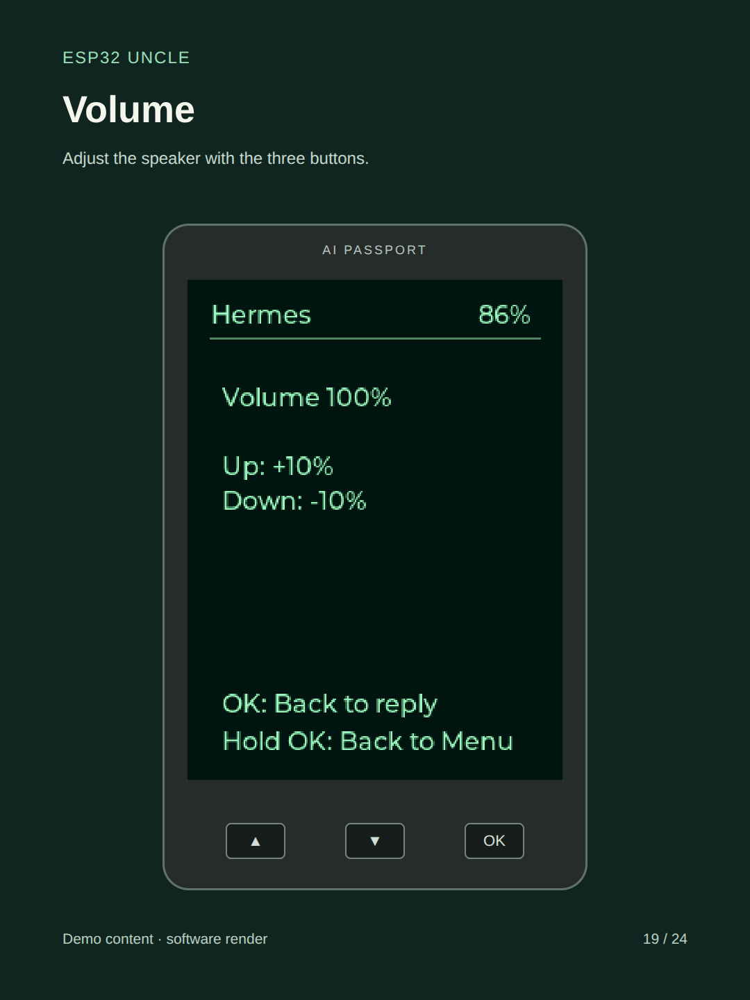</a><br><b>Volume</b><br><sub aria-hidden="true">&#160;&#160;&#160;&#160;&#160;&#160;&#160;&#160;&#160;&#160;&#160;&#160;&#160;&#160;&#160;&#160;&#160;&#160;&#160;&#160;&#160;&#160;&#160;&#160;&#160;&#160;&#160;&#160;&#160;&#160;&#160;&#160;&#160;&#160;&#160;&#160;&#160;&#160;&#160;&#160;&#160;&#160;&#160;&#160;&#160;&#160;&#160;&#160;&#160;&#160;&#160;&#160;&#160;&#160;&#160;&#160;&#160;&#160;&#160;&#160;&#160;&#160;&#160;&#160;&#160;&#160;&#160;&#160;&#160;&#160;&#160;&#160;&#160;&#160;&#160;&#160;&#160;&#160;&#160;&#160;&#160;&#160;&#160;&#160;&#160;&#160;&#160;&#160;&#160;&#160;&#160;&#160;&#160;&#160;&#160;&#160;&#160;&#160;&#160;&#160;&#160;&#160;&#160;&#160;&#160;&#160;&#160;&#160;&#160;&#160;&#160;&#160;&#160;&#160;&#160;&#160;&#160;&#160;&#160;&#160;&#160;&#160;&#160;&#160;&#160;&#160;&#160;&#160;&#160;&#160;&#160;&#160;&#160;&#160;&#160;&#160;&#160;&#160;&#160;&#160;</sub></td>
<td><a href="https://benczb.github.io/esp32-uncle/?lang=en">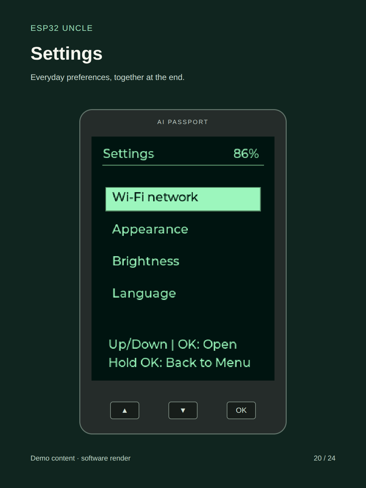</a><br><b>Settings</b><br><sub aria-hidden="true">&#160;&#160;&#160;&#160;&#160;&#160;&#160;&#160;&#160;&#160;&#160;&#160;&#160;&#160;&#160;&#160;&#160;&#160;&#160;&#160;&#160;&#160;&#160;&#160;&#160;&#160;&#160;&#160;&#160;&#160;&#160;&#160;&#160;&#160;&#160;&#160;&#160;&#160;&#160;&#160;&#160;&#160;&#160;&#160;&#160;&#160;&#160;&#160;&#160;&#160;&#160;&#160;&#160;&#160;&#160;&#160;&#160;&#160;&#160;&#160;&#160;&#160;&#160;&#160;&#160;&#160;&#160;&#160;&#160;&#160;&#160;&#160;&#160;&#160;&#160;&#160;&#160;&#160;&#160;&#160;&#160;&#160;&#160;&#160;&#160;&#160;&#160;&#160;&#160;&#160;&#160;&#160;&#160;&#160;&#160;&#160;&#160;&#160;&#160;&#160;&#160;&#160;&#160;&#160;&#160;&#160;&#160;&#160;&#160;&#160;&#160;&#160;&#160;&#160;&#160;&#160;&#160;&#160;&#160;&#160;&#160;&#160;&#160;&#160;&#160;&#160;&#160;&#160;&#160;&#160;&#160;&#160;&#160;&#160;&#160;&#160;&#160;&#160;&#160;&#160;</sub></td>
<td><a href="https://benczb.github.io/esp32-uncle/?lang=en">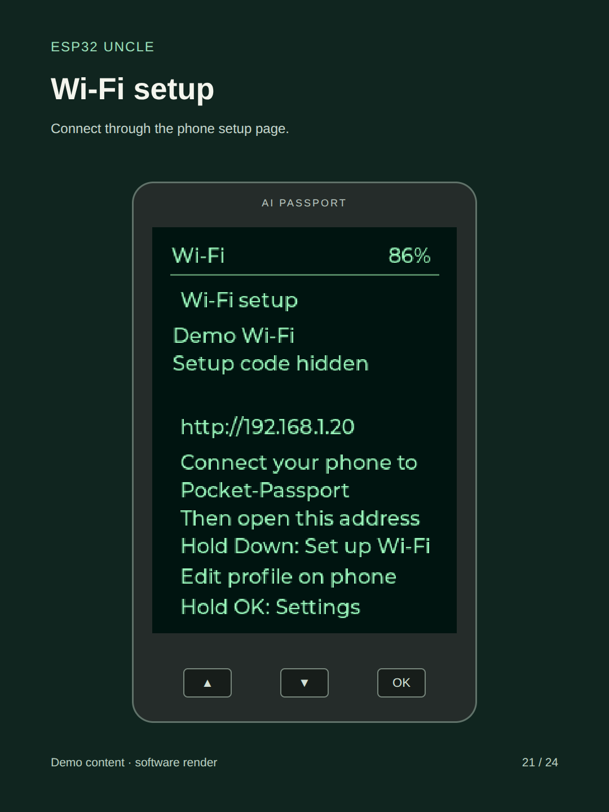</a><br><b>Wi-Fi setup</b><br><sub aria-hidden="true">&#160;&#160;&#160;&#160;&#160;&#160;&#160;&#160;&#160;&#160;&#160;&#160;&#160;&#160;&#160;&#160;&#160;&#160;&#160;&#160;&#160;&#160;&#160;&#160;&#160;&#160;&#160;&#160;&#160;&#160;&#160;&#160;&#160;&#160;&#160;&#160;&#160;&#160;&#160;&#160;&#160;&#160;&#160;&#160;&#160;&#160;&#160;&#160;&#160;&#160;&#160;&#160;&#160;&#160;&#160;&#160;&#160;&#160;&#160;&#160;&#160;&#160;&#160;&#160;&#160;&#160;&#160;&#160;&#160;&#160;&#160;&#160;&#160;&#160;&#160;&#160;&#160;&#160;&#160;&#160;&#160;&#160;&#160;&#160;&#160;&#160;&#160;&#160;&#160;&#160;&#160;&#160;&#160;&#160;&#160;&#160;&#160;&#160;&#160;&#160;&#160;&#160;&#160;&#160;&#160;&#160;&#160;&#160;&#160;&#160;&#160;&#160;&#160;&#160;&#160;&#160;&#160;&#160;&#160;&#160;&#160;&#160;&#160;&#160;&#160;&#160;&#160;&#160;&#160;&#160;&#160;&#160;&#160;&#160;&#160;&#160;&#160;&#160;&#160;&#160;</sub></td>
<td><a href="https://benczb.github.io/esp32-uncle/?lang=en">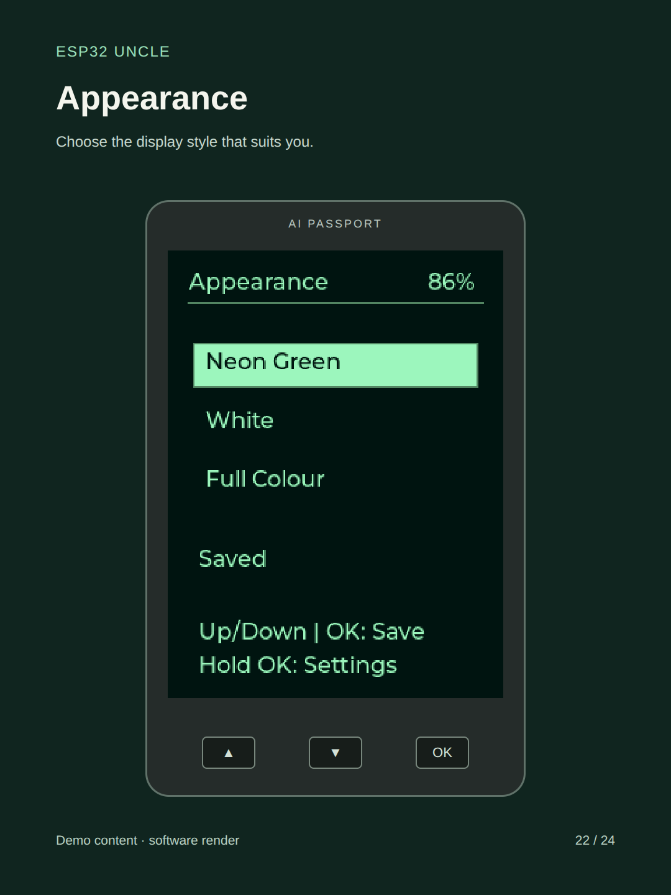</a><br><b>Appearance</b><br><sub aria-hidden="true">&#160;&#160;&#160;&#160;&#160;&#160;&#160;&#160;&#160;&#160;&#160;&#160;&#160;&#160;&#160;&#160;&#160;&#160;&#160;&#160;&#160;&#160;&#160;&#160;&#160;&#160;&#160;&#160;&#160;&#160;&#160;&#160;&#160;&#160;&#160;&#160;&#160;&#160;&#160;&#160;&#160;&#160;&#160;&#160;&#160;&#160;&#160;&#160;&#160;&#160;&#160;&#160;&#160;&#160;&#160;&#160;&#160;&#160;&#160;&#160;&#160;&#160;&#160;&#160;&#160;&#160;&#160;&#160;&#160;&#160;&#160;&#160;&#160;&#160;&#160;&#160;&#160;&#160;&#160;&#160;&#160;&#160;&#160;&#160;&#160;&#160;&#160;&#160;&#160;&#160;&#160;&#160;&#160;&#160;&#160;&#160;&#160;&#160;&#160;&#160;&#160;&#160;&#160;&#160;&#160;&#160;&#160;&#160;&#160;&#160;&#160;&#160;&#160;&#160;&#160;&#160;&#160;&#160;&#160;&#160;&#160;&#160;&#160;&#160;&#160;&#160;&#160;&#160;&#160;&#160;&#160;&#160;&#160;&#160;&#160;&#160;&#160;&#160;&#160;&#160;</sub></td>
<td><a href="https://benczb.github.io/esp32-uncle/?lang=en">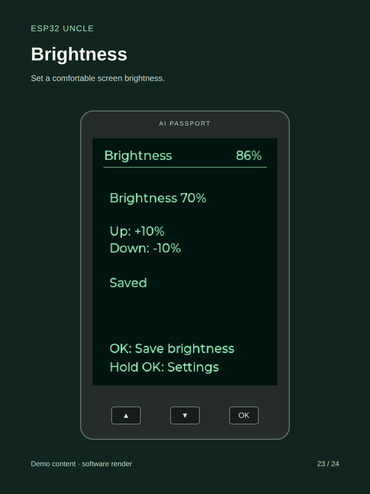</a><br><b>Brightness</b><br><sub aria-hidden="true">&#160;&#160;&#160;&#160;&#160;&#160;&#160;&#160;&#160;&#160;&#160;&#160;&#160;&#160;&#160;&#160;&#160;&#160;&#160;&#160;&#160;&#160;&#160;&#160;&#160;&#160;&#160;&#160;&#160;&#160;&#160;&#160;&#160;&#160;&#160;&#160;&#160;&#160;&#160;&#160;&#160;&#160;&#160;&#160;&#160;&#160;&#160;&#160;&#160;&#160;&#160;&#160;&#160;&#160;&#160;&#160;&#160;&#160;&#160;&#160;&#160;&#160;&#160;&#160;&#160;&#160;&#160;&#160;&#160;&#160;&#160;&#160;&#160;&#160;&#160;&#160;&#160;&#160;&#160;&#160;&#160;&#160;&#160;&#160;&#160;&#160;&#160;&#160;&#160;&#160;&#160;&#160;&#160;&#160;&#160;&#160;&#160;&#160;&#160;&#160;&#160;&#160;&#160;&#160;&#160;&#160;&#160;&#160;&#160;&#160;&#160;&#160;&#160;&#160;&#160;&#160;&#160;&#160;&#160;&#160;&#160;&#160;&#160;&#160;&#160;&#160;&#160;&#160;&#160;&#160;&#160;&#160;&#160;&#160;&#160;&#160;&#160;&#160;&#160;&#160;</sub></td>
<td><a href="https://benczb.github.io/esp32-uncle/?lang=en">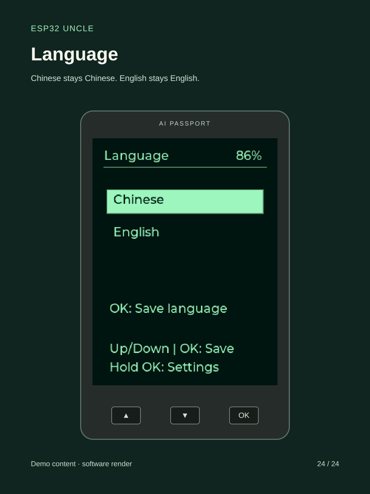</a><br><b>Language</b><br><sub aria-hidden="true">&#160;&#160;&#160;&#160;&#160;&#160;&#160;&#160;&#160;&#160;&#160;&#160;&#160;&#160;&#160;&#160;&#160;&#160;&#160;&#160;&#160;&#160;&#160;&#160;&#160;&#160;&#160;&#160;&#160;&#160;&#160;&#160;&#160;&#160;&#160;&#160;&#160;&#160;&#160;&#160;&#160;&#160;&#160;&#160;&#160;&#160;&#160;&#160;&#160;&#160;&#160;&#160;&#160;&#160;&#160;&#160;&#160;&#160;&#160;&#160;&#160;&#160;&#160;&#160;&#160;&#160;&#160;&#160;&#160;&#160;&#160;&#160;&#160;&#160;&#160;&#160;&#160;&#160;&#160;&#160;&#160;&#160;&#160;&#160;&#160;&#160;&#160;&#160;&#160;&#160;&#160;&#160;&#160;&#160;&#160;&#160;&#160;&#160;&#160;&#160;&#160;&#160;&#160;&#160;&#160;&#160;&#160;&#160;&#160;&#160;&#160;&#160;&#160;&#160;&#160;&#160;&#160;&#160;&#160;&#160;&#160;&#160;&#160;&#160;&#160;&#160;&#160;&#160;&#160;&#160;&#160;&#160;&#160;&#160;&#160;&#160;&#160;&#160;&#160;&#160;</sub></td>
</tr></tbody></table>

## 🎬 Launch films

https://github.com/user-attachments/assets/6b7cf0e2-719f-4cdf-8765-84fe11898c2d

https://github.com/user-attachments/assets/257cc789-d551-45c1-ab0a-f0e6ade3930a

## ✨ One little device, everyday apps and views

| App | What it brings |
| --- | --- |
| 🚌 Bus arrivals | Your chosen favourite stops and three arrival estimates, using your own LTA API key |
| 🚆 Train alerts | LTA service alerts and disruption-trip details, with a one-line homepage notice |
| 📊 AI Usage | Your connected accounts' remaining quota and reset countdowns, through your own usage tracker |
| 💬 Hermes | Phone text input, replies paged on the Passport |
| 🪄 Muse | Official Muse AI through Muse Passport · integration in progress |
| 🪪 Profile card | Name, photo and LinkedIn / WhatsApp / WeChat link QR; press OK to switch views, including an NFC tap hint |
| 📻 Radio | Six Singapore and four Malaysian station presets |
| 🌦️ Weather | Singapore, Johor Bahru, Kuala Lumpur and Penang |
| 🚦 Traffic light | A Singapore pedestrian crossing: real push-button sound, red waiting man, then green walking man and countdown |
| 🔗 Contact QR view | Separate from the crossing view: switch to contact QRs. The public gallery shows only the authorized [LinkedIn profile](https://www.linkedin.com/in/ben-cheng) QR |
| 🧭 Navigation | Komoot phone directions over BLE; available on the [navigation / music / books branch](https://github.com/benczb/esp32-uncle/tree/feature/navigation-spotify-books) |
| 🎵 Spotify remote | Playback status, previous/next and play/pause through the computer companion; feature branch |
| 📖 Books | TXT/EPUB upload from your phone, bookshelf selection and saved reading position; feature branch |
| ⚙️ Settings | Chinese / English, profile QR, photo, Wi-Fi, city, PSI region and bus favourites |


The homepage header shows the local day and 24-hour time, such as **MON 12:55**.
It updates each minute; **--- --:--** means the clock has not synchronised.
The portrait homepage also shows **NEA 24-hour PSI**.
The device has no GPS: select a region or update saved coordinates after moving.


### Traffic Light and contact QRs

**Traffic Light** handles the crossing sequence and sound. **Contact QR** is its
separate contact view: OK switches views, and Up/Down selects the configured
contact link. These remain two views of the Traffic Light app on `main`; the
README and gallery present them separately so the crossing and contact sharing
are easy to find. The gallery includes red/green crossing images and only the
real [LinkedIn QR](https://www.linkedin.com/in/ben-cheng). Phone numbers,
WeChat/WhatsApp QRs, gadget identifiers and AI-account details are excluded.
Home uses the illustrated portrait supplied and authorized by the owner.

### Phone companion: Android and Apple iPhone

The shared browser companion for **Android (Chrome)** and **iPhone/iPad (Safari)**
is on the [feature branch](https://github.com/benczb/esp32-uncle/tree/feature/navigation-spotify-books).
It detects the phone, lets you select Chinese or English, and provides the
matching permissions and file-upload instructions.

1. Keep the computer companion running; connect the phone and Passport to the
   same home Wi-Fi.
2. On the feature firmware's phone settings page, open **Music and books setup**.
   Enter the companion access token and choose **Connect companion**.
3. Add a TXT or DRM-free EPUB, then choose **Read on Passport**. On iPhone, choose
   the file from **Files**; on Android, use **Files/Downloads**.
4. For navigation, enable Komoot Bluetooth Connect if available, start a route,
   then open **Navigation** on Passport and press OK. This is a direct BLE link.

Books and Spotify need the computer to remain reachable. Default Spotify sign-in
is completed once on the computer; phone sign-in needs a registered HTTPS
callback. The optional Android hotspot/Tailscale relay and official Muse Android
companion are separate functions; this update does not create iPhone versions of
those native/relay features. Live Komoot pairing still needs testing on both phones.
See the [Android/iPhone setup guide](https://github.com/benczb/esp32-uncle/blob/feature/navigation-spotify-books/companion/README.md#android-and-iphone).

The gallery covers `main` and the feature branch. It uses software renders and
demo data, not device photographs or live service readings. Settings remains the
last item in the feature firmware's menu.

## Set up your own Passport

Use your own profile, photo, Wi-Fi networks, favourite bus stops and service
accounts. The instructions below do not require the maintainer's personal setup.
Start with the [application guide](docs/applications/pocket-passport.md).

Think of it as a tiny noticeboard: the **Passport** displays information, your
**Android phone** provides hotspot Internet and settings, and a **private computer
bridge** handles assistants, usage and radio decoding.

## 🚀 Start here

1. Read the [application guide](docs/applications/pocket-passport.md) for controls and setup.
2. To change a photo, join `Pocket-Passport`, open `http://192.168.4.1`, enter the
   current settings code, choose/crop a photo, then save the new avatar.
3. Set up the [computer companion](companion/README.md) for assistants, usage and radio.
4. Connect your own ChatGPT/Codex or Claude account under **AI usage account sign-in** in the settings page; see the [sign-in setup guide](companion/README.md#connect-usage-accounts-during-setup).
5. Read the [public snapshot build notes and upstream credits](docs/applications/esp32superapp-build.md).

### Install from source

You need a FoloToy AI Passport, a USB **data** cable,
and **ESP-IDF 5.5.3**. Do not use firmware intended for another ESP32 board.

```bash
git clone https://github.com/benczb/esp32-uncle.git
cd esp32-uncle
```

Install/activate ESP-IDF using the [step-by-step environment guide](docs/development/engineering/environment-setup.md).
For optional Home/Phone Hotspot presets, copy the safe example and edit only the private copy:

```bash
umask 077
mkdir -p .local
cp config/wifi-profiles.example.json .local/passport-defaults.json
# Edit .local/passport-defaults.json with your own 2.4 GHz network details.
```

Leave `.local/` absent if you prefer manual Wi-Fi setup on the phone.
Then build and verify:

```bash
./tools/validate.sh
./tools/render_passport.sh
```

The verified image is `build/FoloToy-AI-Passport-full.bin`. For a blank device or
an intentional full refresh, use the [flashing guide](docs/development/engineering/firmware-layout.md#flashing-and-stored-data)
and flash the **merged** image from `0x0`. Existing settings may be reset; an
upgrade that must retain them needs the matching application image and compatible
partition layout. A USB connection alone is not permission to flash.

If you prefer not to install the toolchain locally, authorized collaborators can
run **Actions → Build firmware → Run workflow** and download its artifact when
the workflow completes. Those clean builds contain no personal Wi-Fi presets.

The target is **ESP32-C3, 8 MB flash, no PSRAM**, with the original FoloToy BSP.
Firmware archives are generated locally and are not committed.

## 🔊 Assistant replies and volume

Hermes replies play through the Passport speaker using local eSpeak NG speech
on the computer bridge (`espeak-ng` and `ffmpeg` must be installed). Muse uses
the original Muse Passport Android companion's reply-speech feature over
Bluetooth; enable speech in that companion and keep it connected. This requires
the Muse-enabled firmware. No separate speech API key is needed.

On either assistant page, press **OK** for volume, then **Up/Down** to adjust by
10%. The percentage is shown on screen; **0% mutes**. Press **OK** again to
return to the reply, or **hold OK** to return to Menu. The setting is shared
with Radio for the current session. Outside the volume panel, hold **Down** to
record and release to send. Leaving the assistant or starting a recording stops
its playback. Hermes needs the computer bridge; away from home, keep the phone
browser relay connected for reply audio. Readable reply text remains available
if audio is unavailable.

## 📱 Set up from your phone

Configure your own display name, contact details, profile photo and optional QR
link. Enter your own 2.4 GHz Wi-Fi details, select a supported weather city and
PSI region, and replace any prefilled bus favourites with your own stop codes.
Assistant and usage features need your own bridge URL, access token and accounts;
bus and train data need your own LTA DataMall key. Never use someone else's
credentials or copy their private firmware configuration.

You use the Passport's buttons to open Settings, then your phone browser to
edit the details. No USB cable or phone app is needed for the settings page.

Keep the Passport in **Settings → Wi-Fi network** while editing and wait for **Settings saved.**
before leaving. The phone page is available in Wi-Fi settings, Hermes and AI Usage.
During an active phone relay it also stays available in Radio, the Settings submenu and Menu, and on
Home while the `Pocket-Passport` setup hotspot is enabled. On other screens,
reopen Settings and refresh your phone browser to continue editing.

While native radio or Hermes speech plays, weather uses the same private
computer bridge to avoid a second HTTPS connection on the Passport. During a
phone relay, keep the browser page open: the phone forwards weather as well as
audio. Otherwise weather connects directly to Open-Meteo, falling back to the
configured bridge if the direct request fails, including low-memory TLS failures.
PSI also falls back to the bridge when its direct request cannot complete,
using the same saved region or location.

### Appearance and the Settings submenu

Open **09 Settings** from the menu. Choose **Wi-Fi network** for phone setup,
**Language** for English/Chinese, **Brightness** for a screen level, or **Appearance** for **Neon Green**, **White**, or **Full Colour**. Up/Down
previews a colour choice; **OK** saves it on the Passport. **Saved** confirms
success, and the choice survives a restart. Hold OK returns to Settings;
hold OK again returns to the menu. Neon Green remains the default. White uses
white text on black; Full Colour adds blue navigation and amber selection.
Bus Arrivals is first, Train Alerts second, and Profile Card follows Muse.

In **Brightness**, Up/Down previews levels from **10% to 100%** in 10% steps.
Press **OK: Save brightness** to keep the level after restart; the default is
70%. Hold OK returns to Settings and restores the last saved level if you
leave without saving. The minimum keeps the display visible.

Choose **English** or **Chinese** in **Settings → Language**, then press **OK** to
save. Hold OK returns to Settings. Language changes no longer use Hold Up
on the Wi-Fi page.

New photo uploads retain their original colour. White displays the photo in
greyscale without changing its saved source. Older photos uploaded with a green
tint keep that tint in Full Colour; upload the original again to restore colour.
The phone setup form also offers the same three appearance choices.

### 1. Open the phone settings page

1. On the Passport, press **OK** on the homepage to open **Menu**, choose
   **09 Settings**, press **OK**, then open **Wi-Fi network**.
2. If the Passport is already connected to Home Wi-Fi, connect your phone to
   the **same home network**. If the Passport is connected to your phone's
   hotspot, keep that hotspot on and use its host phone.
3. Type the **full address shown on the Passport** into your browser's address
   bar, including `http://`. It is the Passport's address, not your router's
   address or your computer's address.
4. Enter the **six-digit Device setup code** shown on the Passport. Tap outside
   the code box to load your saved profile. Wait for **Profile loaded and clock
   synchronised** before editing. You can then choose **English** or Chinese
   in the page's Language selector.

| How you are connected | Address to open on your phone |
| --- | --- |
| Phone joined the Passport's own `Pocket-Passport` setup Wi-Fi | `http://192.168.4.1` |
| Passport and phone on Home Wi-Fi | The Passport's displayed `http://192.168.x.x` address |
| Passport connected to Phone Hotspot | The Passport's displayed address, which may start with `172.` or `192.168.` |

**Not connected yet?** In Passport Settings, **hold Down: Set up Wi-Fi**.
On your phone, open Android **Settings → Wi-Fi**, join **Pocket-Passport** using
its displayed **Key/password**, and open `http://192.168.4.1`. Choose **stay
connected / use this network anyway** if Android says it has no Internet.
This Wi-Fi is a local setup connection; it does not provide Internet itself.

The hotspot **Key** joins that Wi-Fi. The six-digit **Code** unlocks the web
settings. Both can change after a restart; use what the device currently shows.
A changing setup password does **not** mean your saved Home Wi-Fi was erased.
If the page stops opening after a network change, reopen Settings and use the
new address. Type the address into the URL bar rather than a search box.

### 2. Connect Home Wi-Fi or Phone Hotspot

Use a **2.4 GHz** network; the ESP32-C3 cannot join a 5 GHz-only network.

| At home | Away from home |
| --- | --- |
| Keep your home router on. | On Android, enable **Settings → Hotspot & tethering → Wi-Fi hotspot**; choose 2.4 GHz or compatibility mode. Menu names vary by phone. |
| In Passport Settings, use **Up/Down: Choose Wi-Fi network** to select **Home**. | Select **Phone Hotspot** on the Passport. |
| Press **OK: Connect** and wait for **Wi-Fi connected**. | Press **OK: Connect** and keep the hotspot on while using online features. |

**Adding or correcting credentials on the phone:** under **Network and city**,
choose an available saved profile or **Enter manually**. Enter the exact Wi-Fi
name and password, including capital letters, spaces and punctuation. Click
**Save settings**, wait for the success message, then hold **OK: Back to Menu**
on the Passport and restart it to use the new network. For an existing preset,
you can instead select that profile in device Settings and press **OK: Connect**.
Leaving Settings or closing the browser alone does not save web-form changes.

Saved password boxes are deliberately blank when you reopen the page. Leave
one blank to keep its existing password; enter a replacement to change it.
The **Home / Phone Hotspot presets only exist if supplied in your private build
configuration**. A clean build can use manual entry for the current network;
see [Install from source](#install-from-source) to configure both presets with
your own credentials. Nobody else's home or hotspot password is included.

If the phone cannot keep its own hotspot running while joining `Pocket-Passport`,
configure the Passport on Home Wi-Fi first, or use a second phone for setup.
Once connected to Phone Hotspot, open the Passport's assigned address directly
from the hotspot phone; you do not need to join `Pocket-Passport` again.

### 3. Change your photo, profile and QR code

1. Open the phone settings page and load your profile with the current setup code.
2. Under **Profile card**, choose a photo smaller than **15 MB**. Adjust **Zoom**,
   **Horizontal position** and **Vertical position** until the preview looks right.
3. Click **Save new photo**. Wait for **Photo saved to the device and retained
   after restart**. This is a separate action from **Save settings**.
4. Return to the Passport's homepage or Profile card. The new photo appears
   automatically; no firmware flash or restart is required.
5. Edit your display name, tagline, contact or **Profile QR link**, then click
   **Save settings** to save those fields. Use a LinkedIn profile URL,
   `https://wa.me/<country-code-and-number>`, or a suitable WeChat share link.
   On the Passport's **Profile card**, press **OK** to toggle the QR view.

The image is cropped in your browser and stored as an **80 × 112** portrait on
the Passport. It is not uploaded to a photo cloud. Photos and saved settings
survive normal restarts and battery use. A firmware erase or incompatible
update can remove them, so keep your original photo. Uploading a replacement
photo does not save other unsaved form edits.

**NFC tap:** the Passport also carries a passive NTAG213 NFC tag, which is
not connected to the ESP32-C3 — the firmware cannot write it or detect a tap.
Write it once from your phone with an NFC writer app (such as NFC Tools):
add a URL/URI record with the same link as your **Profile QR link**, then hold
the phone against the NFC mark on the back. After that, most phones open the
link when tapped against the back, with no app needed and even with the
Passport switched off. Press **OK** twice on the Profile card for the NFC
view that explains this to the other person. See the
[application guide](docs/applications/pocket-passport.md#nfc-tap-to-profile)
for the full setup, the one-fixed-link limit, and locking the tag.

**Screensaver:** on every screen, the display sleeps after 10 seconds without
a button press — backlight off, and bus, weather and train fetching stops
until the next press, which only wakes the display and then refreshes the
current page. Wi-Fi stays associated in modem power-save rather than paying
a reconnect on every wake. Radio playback, voice use, and an open phone
setup page keep the display awake.

### 4. Know when changes have saved

The confirmation appears **on your phone**, immediately **below the Save settings
button** in the Computer bridge section, and again near the bottom of the page.
It is not a line on the Passport's screen.

| What you changed | Action | Success message / next step |
| --- | --- | --- |
| Photo | **Save new photo** | Photo saved to the device and retained after restart; return to Home/Profile card |
| Name, QR link, language, city, PSI region, bus stops or bridge details | **Save settings** | **Settings saved.** |
| Wi-Fi credentials or selected profile in the web form | **Save settings** | **Settings saved.** Then restart, or use the device's saved-profile Connect action |
| Saved Wi-Fi profile using the Passport buttons | **OK: Connect** | Selected profile is saved and the device attempts connection; look for **Wi-Fi connected** |
| Provider account authorization | Complete official sign-in | **Account connected** in the AI usage account section |

If you see an error rather than a success message, the action has not been
confirmed. Keep the page open, correct the error and retry. Saved Wi-Fi passwords
and the bridge access token are never filled back into the form.

### 5. Connect ChatGPT / Codex and Claude usage

First prepare the **computer bridge**, **Athena Usage Tracker** and the official
CLI for the provider you want; follow the [account sign-in setup guide](companion/README.md#connect-usage-accounts-during-setup).
The tracker normally listens on **4177**; the Passport talks to the bridge on
**4188**. These are different services.

1. Keep the computer awake and ensure your phone can reach it. At home, use the
   computer's LAN bridge address, for example `http://<computer-LAN-IP>:4188`.
   Do **not** enter `192.168.4.1` here: that address is for Passport setup.
2. In the phone page, enter the **Service URL** and **Service access token** from
   your bridge setup. Save them if you want the Passport to use that bridge.
   **After saving, re-enter the token before account sign-in**; saving clears
   the visible token field while keeping the saved device value.
3. Under **AI usage account sign-in**, choose **ChatGPT / Codex** or **Claude Code**,
   enter an account name, and click **Add usage account**. For an existing setup
   account, use **Load accounts** and select it instead.
4. Click **Connect selected account**. For **ChatGPT / Codex**, open the official
   sign-in page and enter the one-time sign-in code displayed on the phone page.
   Complete the provider's consent steps. For **Claude Code**, complete its
   official browser sign-in **on the bridge computer**, where its localhost
   callback is reachable.
5. Wait for **Account connected**, then open **AI Usage** on the Passport and
   press **OK** to refresh. **Up/Down** moves between accounts. An unfinished
   login can be stopped with **Cancel this sign-in**.

The one-time **provider sign-in code** is different from the Passport's six-digit
**Device setup code**. Enter provider passwords only on the provider's official
sign-in page. Provider credentials stay in the computer's private CLI profile,
not in the firmware or GitHub repository.

ChatGPT sign-in supplies **Codex remaining usage and reset times**, not a separate
ChatGPT message allowance or a dollar balance. Claude values also need the
tracker's Claude status-line/sync data: login alone may still show **unavailable**.
You can use either provider without connecting the other.

### 6. Use the bridge outside your home

Turn on Android **Phone Hotspot** and **Tailscale**, and connect the Passport to
Phone Hotspot. The phone's Tailscale connection does **not** automatically give
hotspot clients access to your private computer.

On the phone settings page, enter the computer's **Tailscale service URL**
(`http://<computer-Tailscale-IP>:4188`) and re-enter the bridge **Service access
token**. Click **Connect phone relay**, and keep the page in the foreground and
the phone awake. For Hermes text, choose the phone-relay option and open
**Hermes** on the Passport before sending. Some Android browsers restrict local
network requests; use the error shown on the page if it cannot connect.

For microphone input, open **Hermes**, hold **Down**, wait for **Recording**, then
speak and release Down to submit. Hold OK to leave and cancel an unfinished
recording. Keep the phone page open until the reply arrives; it forwards the
microphone audio and the spoken reply. Device microphone upload/cancellation
has been tested with an authenticated relay client, and the owner confirmed a
complete spoken reply through the Android hotspot/Tailscale relay. Browser and
phone compatibility can vary; check the connection status on your own device.

Returning Home or opening Profile Card, Weather, Bus or Muse ends the browser
relay. Reconnect from Settings for another session. Muse uses its separate
Android Bluetooth companion connection.

For account sign-in, the page uses the **Computer Tailscale service URL** when
filled, otherwise the regular Service URL. Clear an old Tailscale address if you
intend to use the LAN address instead. Account sign-in needs Internet, so leave
the Internet-free `Pocket-Passport` setup Wi-Fi and use your normal network when
completing official authorization.

Weather, NEA PSI and bus arrivals use the Passport's Internet connection directly.
Hermes, AI Usage and radio need the running computer bridge; phone relay also
needs its browser page to stay open. Muse uses the separate official Muse
Passport integration, which is still in progress. USB can be unplugged for
battery use once setup is saved.

### 7. Understand messages and notifications

These are **on-screen status messages**, not phone push notifications, SMS or
background messages from every app. Opening a function starts its work; leaving
it stops its polling, playback and unsent recording. An assistant request already
submitted may still finish. Wi-Fi stays available and weather can refresh in the
background. There is no automatic incoming Hermes/Muse push feed.

| Message / indicator | Meaning and what to do |
| --- | --- |
| **Profile loaded and clock synchronised** | The setup code was accepted and saved values loaded; you can edit now |
| **Settings saved.** / photo-saved message | The corresponding save succeeded; the two save buttons are independent |
| **Wi-Fi connected** | Passport joined Wi-Fi; it does not prove the computer bridge is reachable |
| **Connecting to…** | A connection attempt is running; wait for success or failure |
| **Wi-Fi failed (…) / OK: retry** | The bounded attempt ended; check exact credentials and 2.4 GHz, then press OK to retry |
| **Choose your current region** / PSI `--` | Select an NEA region in phone settings and save; the Passport has no GPS |
| **Stale / cached / offline** | Information may be old or its source is unreachable; check Internet and refresh |
| **Arr** in bus timings | The bus is arriving; the other numbers are minutes. `--` is unavailable, not zero minutes |
| **Low RAM / Retry shortly** | Working memory is insufficient, not photo storage being full; stop radio/recording and retry, or restart |
| **Offline / Check computer bridge** | Check that the computer and bridge are running and the URL/token are correct |
| **Phone relay connected / disconnected** | Browser relay started/stopped; reconnect and keep the page awake if needed |
| **Waiting for account authorization / Account connected** | Finish official sign-in / the login succeeded; quota availability is a separate check |
| **Recording / Release Down to send** | Hermes microphone capture is active; release to submit, or hold OK to leave and cancel an unsent recording |
| **Vol …%** | Current radio volume; hold Up/Down to adjust |

For PSI, choose your current Singapore region under **Singapore haze → Current
region**, then **Save settings**. The homepage displays the published **NEA
24-hour PSI**, not a live indoor sensor reading. Choose the city separately for
weather. For buses, save up to ten favourites as `stop code | name`, one per line.
The [full application guide](docs/applications/pocket-passport.md) covers controls.

### Bus data source and API access

Bus arrivals now use **LTA DataMall directly**, with your own **Account Key**.
There is no Bus Aunty API fallback. In the phone settings page, load your profile,
enter the key in **LTA API key**, and click **Save settings**. Then open bus
arrivals and press **OK**. Leave the field blank on later edits to retain the
saved key; it is never filled back into the form. It is not your bridge token.

Request your key through [LTA DataMall](https://datamall.lta.gov.sg/content/datamall/en/request-for-api.html).
Data is provided by the **Land Transport Authority, Singapore**, under the
[Singapore Open Data Licence](https://data.gov.sg/open-data-licence) and
[LTA API terms](https://datamall.lta.gov.sg/content/datamall/en/api-terms-of-service.html).
Destination codes are shown as **To stop …**; the small update time is the last
successful fetch time. See the [bus setup details](docs/applications/pocket-passport.md#bus-arrivals-lta-datamall)
for caching and optional bridge-side configuration. Existing Bus Aunty Mini
copyright credits remain; this project is independent of both operators.

Weather uses Open-Meteo's free, keyless endpoint for personal/non-commercial
use. Commercial products need an appropriate hosted API plan; see
[Open-Meteo pricing](https://open-meteo.com/en/pricing).

## 🔒 Your credentials stay yours

Private Wi-Fi profiles and device/photo backups live under **`.local/`**, which
is Git-ignored. A clean clone contains no personal network credentials. Private
builds can embed those profiles, so their firmware/ELF artifacts must stay local
as well. Never commit the generated header, private backups or raw serial logs.

## 🙏 Sources, copyright and licenses

- **FoloToy AI Passport**: [full upstream project](https://gitee.com/FoloToy/ai-passport),
  baseline `a06235e4c94361e3f8a2d498930254101718acae`.
  **Copyright (c) 2026 FoloToy**, under the [MIT license](LICENSE).
- **Bus Aunty Mini**: [awesomelionel/bus-aunty-mini](https://github.com/awesomelionel/bus-aunty-mini),
  a bus-feature/protocol reference for the independent ESP32-C3 integration.
  **Copyright (c) 2026 awesomelionel**. The complete
  [original MIT notice and disclaimer](assets/licenses/bus-aunty-mini-MIT.txt)
  are included. Keep that notice with copies or substantial portions of its code.
- **Fonts**: Droid Sans Fallback (Apache 2.0) and DejaVu Sans Mono; see the
  [font notices](assets/fonts/NOTICE.txt) and accompanying license files.
- **Visual inspiration**: [Pocket Toolbox, play 438](https://ai-passport.folotoy.cn/plays/438/).
  The screens here are independently implemented; its closed whole-device firmware is not bundled.
- **README inspiration**: [kokoro-onnx](https://github.com/thewh1teagle/kokoro-onnx),
  for the friendly video-first presentation. No code, branding or media was copied.

The Bus Aunty code license is separate from permissions for its hosted API,
branding and website materials. This project is an independent adaptation,
not an official Bus Aunty product.

📚 [All source repositories and their roles](docs/applications/esp32superapp-build.md#where-the-project-came-from)
· [Original FoloToy documentation](docs/README.md)

## 🧩 Dependencies and reference projects

Pinned firmware versions are recorded in `dependencies.lock`; ESP-IDF downloads
managed components during the build. These are actual runtime/build dependencies:

| Component | Upstream repository |
| --- | --- |
| FoloToy project and BSP | [FoloToy/ai-passport](https://gitee.com/FoloToy/ai-passport) · [FoloToy website](https://folotoy.com/) · [Passport platform](https://ai-passport.folotoy.cn/) |
| ESP-IDF 5.5.3 and bundled networking/JSON | [espressif/esp-idf](https://github.com/espressif/esp-idf) · [DaveGamble/cJSON](https://github.com/DaveGamble/cJSON) |
| LVGL 9.5.0 | [lvgl/lvgl](https://github.com/lvgl/lvgl) |
| esp_lvgl_port 2.9.0 | [espressif/esp-bsp](https://github.com/espressif/esp-bsp/tree/master/components/esp_lvgl_port) |
| esp_codec_dev 1.6.2 | [espressif/esp-adf](https://github.com/espressif/esp-adf/tree/master/components/esp_codec_dev) |
| button 4.2.0 / cmake_utilities 1.1.1 | [espressif/esp-iot-solution](https://github.com/espressif/esp-iot-solution) |
| Computer bridge | [Python](https://github.com/python/cpython) standard library · [FFmpeg](https://github.com/FFmpeg/FFmpeg) for radio |
| Intro rendering | [HyperFrames](https://github.com/heygen-com/hyperframes) · [GSAP](https://github.com/greensock/GSAP) (separate license) · [Inter](https://github.com/rsms/inter) |
| Chinese/mono fonts | [Android Droid fonts](https://android.googlesource.com/platform/frameworks/base/) · [DejaVu](https://github.com/dejavu-fonts/dejavu-fonts) · [lv_font_conv](https://github.com/lvgl/lv_font_conv) for regeneration |

### Community projects we credit

| Project / app | Its role here |
| --- | --- |
| [Folo AI Passport Voice](https://github.com/manchunx7-bit/folo-ai-passport-voice) | Voice-feature reference and inspiration |
| [Tokens-Kanban](https://github.com/GreentailTohru-arch/Tokens-Kanban) | AI usage-tracker reference |
| [Athena Usage Tracker](https://github.com/luckeyfaraday/athena-usage-tracker) | Local usage/account registry API used by the companion setup and quota adapter |
| [Muse Passport](https://github.com/FalkoWing/muse-passport) | Official Muse AI app and Android companion target; encrypted pairing core adapted under [Apache-2.0](main/muse/LICENSE), [port details](main/muse/README.md); integration in progress |
| [Xiaozhi AI Chatbot](https://ai-passport.folotoy.cn/plays/xiaozhi-ai-chatbot/install/) | Official community app and installation reference |

Thanks to these creators for sharing their work. These links credit references;
they do not imply that their complete applications or every feature are included.
Additional references: [Bus Aunty Mini](https://github.com/awesomelionel/bus-aunty-mini),
[AI Passport Muse](https://github.com/manchunx7-bit/ai-passport-muse), and
[AI Passport TV](https://github.com/zpdeng1020-coder/ai-passport-tv).
Hermes uses a user-provided compatible API. Muse means the official Muse AI app
and Muse Passport companion.

## 🤝 Contributing and support

This is a personal, volunteer-maintained project; there is no guaranteed response
or support schedule. Small fixes, translations, tests and hardware findings are
welcome. Open an issue before proposing a large feature, include reproduction
steps, and remove personal information from logs.

- [Contributing and test requirements](.github/CONTRIBUTING.md)
- [Code of conduct](.github/CODE_OF_CONDUCT.md)
- [Support](.github/SUPPORT.md) · [Report an issue](https://github.com/benczb/esp32-uncle/issues)
- [Security reporting](.github/SECURITY.md), keep credentials and exploit details private.

The source uses the stated licenses, but this repository remains **private** until
the owner chooses otherwise. Licensing a project is separate from making its
GitHub visibility public. This project follows the documentation and contribution
principles in [Open Source Guides](https://opensource.guide/best-practices/).

## 🚆 Train disruption alerts

Open **02 Train alerts** in the menu. It reuses the **LTA API key** saved for bus
arrivals. **Up/Down** pages through LTA's message text, affected route/stop IDs,
active periods, causes/effects and trip delay/cancellation details. **OK** requests
a refresh; **Hold OK** returns to the menu. Source messages retain their original
language; the surrounding interface follows your Chinese/English setting.

An active alert replaces the homepage's NEA metadata strip with a single-line
train notice. PSI and weather cards remain visible. Open Train alerts for the
full paged details. With no reported alerts, the usual NEA strip returns.

The Passport fetches LTA's **GTFS Realtime Train Service Alerts** and **Train Trip
Updates – Disruption** feeds directly over Wi-Fi while Home or Train alerts is
open, at most once every two minutes automatically. It downloads a fresh signed
link for each fetch. Your key is sent only to DataMall, never to the download
host. No extra account key or computer bridge is needed, although your DataMall
account must have access to both datasets.

**Unavailable, partial and cached are not an all-clear.** On a failed request,
known alerts remain marked cached and the app reports the error. A successful
empty feed means LTA currently reports no entries; it is not a guarantee that
all trains are running normally. The app preserves supplied text rather than
writing an AI summary. Feed/download and detail-memory limits are described in
the [application guide](docs/applications/pocket-passport.md#train-alerts).

Source: [LTA DataMall API guide, sections 2.32–2.33](https://datamall.lta.gov.sg/content/dam/datamall/datasets/LTA_DataMall_API_User_Guide.pdf)
and the [GTFS Realtime specification](https://gtfs.org/documentation/realtime/reference/).
